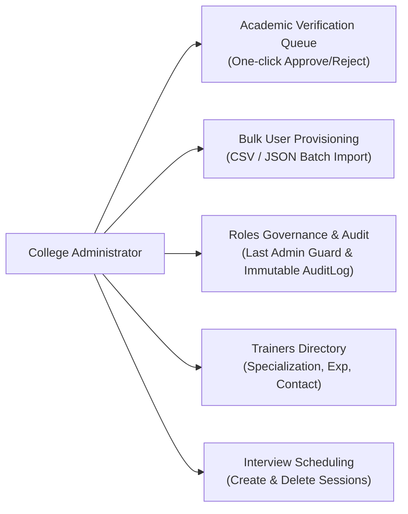
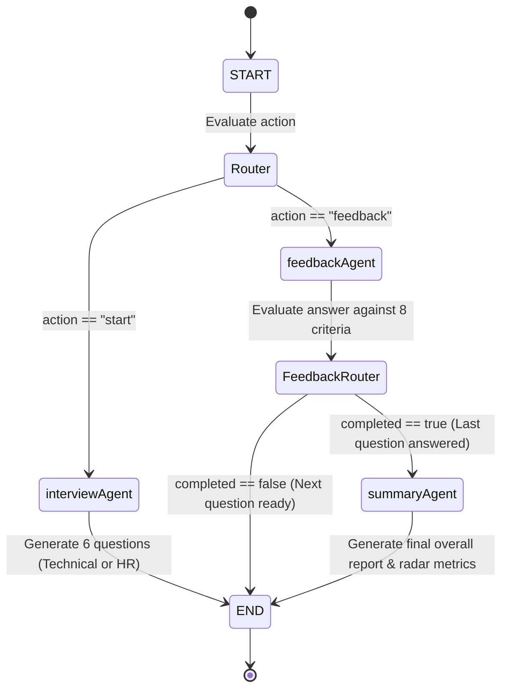

<div align="center">

  

# YUGAM (युगम्)

### _Institutional Campus Placement, Real-Time WebRTC Live Studio & Multi-Agent AI Interview Intelligence Platform_

[](#system-architecture)
[](#frontend-client)
[](#microservices-deep-dive)
[](#yugam-live-studio--real-time-webrtc-video-room)
[-brightgreen.svg)](#automated-testing-suite)
[](#ai--langgraph-agent-workflows)
[](#data-storage--redis-caching)
[](#billing-service-port-8005)
[](LICENSE)

<p align="center">
  <b>Yugam</b> is an enterprise-grade, multi-tenant institutional assessment and career copilot platform. Engineered for universities and tech academies, Yugam connects <b>College Administrators</b>, <b>Technical Faculty Trainers</b>, and <b>Candidate Students</b> under a unified institution ecosystem. It powers end-to-end placement readiness—from <b>verifiable academic profiles</b> and <b>ATS resume scoring</b>, to <b>scheduled faculty-led WebRTC live video interviews</b> with real-time shared coding, and <b>autonomous conversational AI mock interviews</b>.
</p>

---

</div>

## 📑 Table of Contents

- [Executive Overview & Value Proposition](#-executive-overview--value-proposition)
- [Key Platform Features](#-key-platform-features)
- [Role-Based Portals & Multi-Role Authentication](#-role-based-portals--multi-role-authentication)
  - [Dedicated Multi-Role Authentication (`/login` & `/signup`)](#dedicated-multi-role-authentication-login--signup)
  - [1. Institutional Admin Portal](#1-institutional-admin-portal)
  - [2. Technical Faculty Trainer Portal](#2-technical-faculty-trainer-portal)
  - [3. Candidate Student Portal](#3-candidate-student-portal)
- [Yugam Live Studio — Real-Time WebRTC Video Room](#-yugam-live-studio--real-time-webrtc-video-room)
  - [Signaling Architecture & WebRTC P2P Topology](#signaling-architecture--webrtc-p2p-topology)
  - [Real-Time Interactive Workspace](#real-time-interactive-workspace)
  - [6-Criteria Live Candidate Evaluation Rubric](#6-criteria-live-candidate-evaluation-rubric)
  - [Synchronized Call-Ended & Auto-Redirect Workflow](#synchronized-call-ended--auto-redirect-workflow)
- [Student Performance Directory & Formula-Safe Exports](#-student-performance-directory--formula-safe-exports)
  - [Expandable Directory & Discrete Academic Indicators](#expandable-directory--discrete-academic-indicators)
  - [Server-Side Formula-Safe Excel & CSV Exports (CWE-1236)](#server-side-formula-safe-excel--csv-exports-cwe-1236)
- [System Architecture](#-system-architecture)
  - [High-Level Microservices Topology](#high-level-microservices-topology)
  - [Gateway Header Sanitization & Identity Propagation](#gateway-header-sanitization--identity-propagation)
  - [AI Agent StateGraph Architecture](#ai-agent-stategraph-architecture)
- [Microservices Deep-Dive](#-microservices-deep-dive)
  - [1. API Gateway (`gateway` :8000)](#1-api-gateway-port-8000)
  - [2. Authentication & Governance Service (`auth` :8001)](#2-authentication--governance-service-port-8001)
  - [3. Resume Intelligence Service (`resume` :8002)](#3-resume-intelligence-service-port-8002)
  - [4. Interview & Live Studio Service (`interview` :8003)](#4-interview--live-studio-service-port-8003)
  - [5. Roadmap & Resource Service (`roadmap` :8004)](#5-roadmap--resource-service-port-8004)
  - [6. Billing & Subscription Service (`billing` :8005)](#6-billing--subscription-service-port-8005)
  - [7. Isolated Code Execution Engine (`codebox` :3000)](#7-isolated-code-execution-engine-port-3000)
- [Automated Testing Suite (50 Tests / 17 Suites)](#-automated-testing-suite-50-tests--17-suites)
- [Frontend Client & Design System](#-frontend-client--design-system)
- [Token & Coin Economics](#-token--coin-economics)
- [API Reference Guide](#-api-reference-guide)
- [Data Storage & Redis Caching](#-data-storage--redis-caching)
- [Environment Variables Matrix](#-environment-variables-matrix)
- [Getting Started & Local Setup](#-getting-started--local-setup)
- [Security, Performance & Best Practices](#-security-performance--best-practices)
- [License & Contributors](#-license--contributors)

---

## 🌟 Executive Overview & Value Proposition

Modern college placement cells and corporate recruitment drives demand more than generic AI practice tools. They require a rigorous, audit-compliant institutional infrastructure that bridges academic performance records with real technical evaluation.

**Yugam** delivers this unified operational paradigm:

1. **Multi-Tenant Institution Scoping**: All users, performance records, schedules, tasks, and audit logs are strictly scoped by `institutionId` (e.g. `"DEFAULT_COLLEGE"`, `"GLA_UNIVERSITY"`), dynamically resolving college identities across all portal headers and reports.
2. **Tri-Role Institutional Hierarchy**: Dedicated capabilities for **Students** (practice & assessment), **Technical Trainers** (scheduling, live evaluation & grading), and **College Admins** (governance, verification, provisioning & audit logs).
3. **Yugam Live Studio (`/live-interview/:scheduleId`)**: Low-latency peer-to-peer WebRTC video studio featuring Socket.IO room signaling, real-time question push, browser Speech-to-Text dictation, synchronized Monaco code editor with multi-language isolated execution, and weighted rubric grading.
4. **Verifiable Academic Directory & Injection-Proof Exports**: Comprehensive performance tracking that keeps 10th %, 12th %, and B.Tech CGPA as discrete, verified indicators. Full-dataset Excel (`.xlsx`) and CSV (`.csv`) exports hardened against **CWE-1236 spreadsheet formula injection**.
5. **Autonomous AI Mock Interviewer**: Conversational LangGraph-driven mock interviews with photorealistic video avatars, speech synthesis, 8-metric radar scoring, and comprehensive post-session audit reports.

---

## ✨ Key Platform Features

| Domain | Institutional & Platform Capabilities |
| :--- | :--- |
| **Authentication & RBAC** | Dedicated `/login` & `/signup` pages with a 3-role tab switcher (`Student`, `Trainer`, `Admin`), Firebase Google OAuth, role-mismatch validation, strict `ProtectedRoute` guards, and clean session logout redirects. |
| **Academic Integrity Guard** | Student profile updates to CGPA and board percentages are diverted to a `pendingAcademicUpdate` buffer until approved or rejected by an authorized Admin or Trainer. |
| **Governance & Security** | Last Admin Guard (`cannot demote or deactivate the last remaining admin`), immutable `AuditLog` collection, Gateway header injection sanitization, and mutual pre-shared service keys (`x-internal-service-key`). |
| **Yugam Live Studio** | P2P WebRTC audio/video feeds, Socket.IO signaling proxied through Gateway (`/socket.io`), live question dispatch, candidate Speech-to-Text dictation, shared synchronized Monaco Code Editor, CodeBox sandbox runner, 6-criteria weighted rubric, and strictly redacted `trainerPrivateNotes`. |
| **Performance Directory** | Searchable by Name or Roll Number, multi-criteria filtering (Section, Course, Semester, Score range, CGPA range, verification status), discrete 3-tier academic badges, and server-side formula-safe Excel/CSV exports. |
| **Interview Scheduling** | Admin & Trainer session scheduling for individual students or full batches/sections, supporting both AI and Live modes, college-sponsored coin exemption, and complete session deletion controls. |
| **Tasks & Assignments** | Faculty assignment authoring with deadlines, student code/text submission workflow, and trainer grading & feedback cycle. |
| **AI Mock Interview Engine**| LangGraph StateGraph agent, strict Technical vs. HR segregation, contextual resume-backed question synthesis, 8-dimensional rubric evaluation, and radar skill analytics. |
| **Isolated Code Execution** | External isolated CodeBox runner supporting JavaScript (Node.js 18), Python (3.8), Java (OpenJDK 17), and C++ (GCC 9) with rate-limiting and token ownership binding. |
| **Resume Intelligence** | PDF magic-byte validation (`%PDF-`), LangChain structured parsing with automatic domain extraction (`suggestedRole`), deterministic ATS scoring across 11+ tracks, and interactive 6-step ATS Resume Builder. |
| **Targeted Roadmaps** | 10 standardized tracks (10 to 40 LPA), 2-stage LangGraph curriculum builder, domain-allowlisted documentation resolution, and YouTube Data API v3 video retrieval. |

---

## 👥 Role-Based Portals & Multi-Role Authentication

### Dedicated Multi-Role Authentication (`/login` & `/signup`)

Yugam provides dedicated authentication pages featuring a 3-tab role selector:

```text
┌─────────────────────────────────────────────────────────────┐
│                       YUGAM PORTAL                          │
│     [ 🎓 Candidate Student ]  [ 👨‍🏫 Trainer ]  [ 🛡️ Admin ]    │
│                                                             │
│         [ G  Sign in with Google (College Account) ]        │
└─────────────────────────────────────────────────────────────┘
```

- **Role Mismatch Guard**: When a user selects a tab (e.g. `Admin`) and authenticates with a Google account already registered as a different role (e.g. `Student`), the backend rejects the login with a clear warning: `"Selected role does not match registered account role"`.
- **Strict Route Protection (`ProtectedRoute`)**: Unauthenticated visitors attempting to reach `/dashboard`, `/live-interview/:scheduleId`, `/interview`, or `/resume` are immediately redirected to the Home page (`/`).
- **Clean Logout Flow**: Clicking the logout icon in the sidebar invokes the backend session invalidation endpoint, terminates the Firebase client session, clears Redux auth state, and immediately redirects all roles to `/`.

---

### 1. Institutional Admin Portal

The **Admin Portal** gives placement cell officers and department heads full control over the college ecosystem:



- **Institutional KPI Counters**: Real-time counters tracking Total Students, Verified Academia Count, Pending Verifications, Scheduled Interviews, and Total Live/AI Sessions Conducted.
- **Academic Verification Queue**: Review submitted updates to Class 10th %, Class 12th %, and B.Tech CGPA. Single-click **Approve** commits values to the verified student profile; **Reject** discards the pending update with audit logging.
- **Permissions & Roles Governance**:
  - Reassign user roles between `student`, `trainer`, and `admin`.
  - **Last Admin Guard**: The system actively prevents demoting or removing the institution's last remaining Admin to eliminate governance deadlocks.
  - **Immutable Audit Logging**: Every administrative action (role changes, academic approvals, bulk provisioning, CSV exports) is permanently appended to `AuditLog`.
- **Bulk User Provisioning**: Upload CSV or JSON files to onboard hundreds of students or trainers in a single transaction with automatic password generation and email mapping.
- **Interactive Trainers Directory**: Expandable cards displaying department, academic designation, technical specializations, industry experience, and direct contact details.
- **Scheduled Interview Management**: View, filter, and delete scheduled sessions across all trainers and sections.

---

### 2. Technical Faculty Trainer Portal

The **Trainer Portal** equips technical instructors to evaluate students both asynchronously and in real time:

- **Trainer Performance Radar**: Aggregated skill radars analyzing student cohort strengths in Problem Solving, Correctness, System Architecture, and Verbal Articulation.
- **Expandable Student Performance Directory**: Search by student name or roll number; filter by section, semester, average score, or CGPA. Expand any student row to view historical interview records and verified marks.
- **Interview Scheduling System**:
  - Target: **Individual Student** (with intelligent resolution by Name, Email, University Roll Number, or ObjectId) or **Batch Section** (e.g. `CS-A`, `IT-B`).
  - Mode: **AI Mock Interview** or **Live Trainer Interview**.
  - College-Sponsored: Scheduled sessions are **coin-exempt** for students.
  - Full deletion support with instant card removal.
- **Task & Assignment Hub**: Create programming or theoretical assignments with hard deadlines, inspect submitted code/documents, and record numerical marks and feedback.
- **Yugam Live Studio Host**: Directly launch scheduled live video interview rooms as host, push real-time technical questions, and record live rubric scores.
- **Conducted Interview History**: Access complete post-interview reports with full question transcripts, code submissions, rubric breakdowns, and **Confidential Faculty Private Notes**.

---

### 3. Candidate Student Portal

The **Student Portal** provides developers and undergraduates with a comprehensive career acceleration hub:

- **Dashboard Overview**:
  - **Upcoming Scheduled Interviews Strip**: Displays faculty-scheduled sessions with interview type, scheduled date/time, and a direct `Join Live Room` button.
  - **Skill Analytics & Benchmark Radar**: 8-dimensional skill radar visualizing progress over time.
  - **KPI Cards**: Total Interviews, Questions Solved, Completed Sessions, and Average Score.
- **Verifiable Academic Profile**: Displays discrete, verifiable academic achievements (`Class 10th %`, `Class 12th %`, `B.Tech Current CGPA`) with real-time status indicators (`Verified` vs. `Pending Approval`).
- **Assigned Tasks Workflow**: View coursework and coding assignments from faculty trainers, submit answers, and review instructor grades.
- **ATS Resume Intelligence**: Upload PDF resumes for instant 11-track skill gap analysis and ATS scoring; build resumes with the 6-step form wizard and export clean ATS-compliant PDFs.
- **Career Roadmap Builder**: Generate modular learning curriculums with official documentation and YouTube tutorials tailored to salary brackets up to 40 LPA.

---

## 🎥 Yugam Live Studio — Real-Time WebRTC Video Room

The **Yugam Live Studio (`/live-interview/:scheduleId`)** delivers a synchronized video room where technical trainers evaluate students in real time:

```text
┌────────────────────────────────────────────────────────────────────────────────────────┐
│ 🔴 YUGAM LIVE STUDIO   SOFTWARE ENGINEER   ⏱️ 14:32   ● Peer Connected   👨‍🏫 FACULTY TRAINER │
├───────────────────────────────────┬────────────────────────────────────────────────────┤
│ [ Local Camera ] [ Remote Camera] │ [ 💬 Live Answer & Voice ] [ 💻 Shared Monaco Code ] │
│ 🎙️ Mic On   📹 Camera On          ├────────────────────────────────────────────────────┤
│                                   │ // Synchronized Monaco Code Editor                 │
│ 📋 Interview Questions (3)        │ function solution() {                              │
│ ┌───────────────────────────────┐ │   // Real-time peer synchronized code...           │
│ │ QUESTION #2            MEDIUM │ }                                                    │
│ │ Implement an LRU Cache with   │ ├────────────────────────────────────────────────────┤
│ │ O(1) get and put operations.  │ [ ▶ Run Code ]  Output: Terminal compiled cleanly    │
│ └───────────────────────────────┘ ├────────────────────────────────────────────────────┤
│ ➕ Push Question to Student       │ 📊 Live Rubric: Correctness, Problem Solving (78/100)│
└───────────────────────────────────┴────────────────────────────────────────────────────┘
```

### Signaling Architecture & WebRTC P2P Topology

```mermaid
sequenceDiagram
    autonumber
    actor Trainer as Faculty Trainer
    participant GW as API Gateway (:8000)
    participant Socket as Interview Socket.IO (:8003)
    actor Student as Candidate Student

    Note over Trainer,Student: Room Initialization & Peer Discovery
    Trainer->>GW: POST /api/interview/live/join/:scheduleId
    Student->>GW: POST /api/interview/live/join/:scheduleId
    GW-->>Trainer: 200 OK (Room authorized, trainer role)
    GW-->>Student: 200 OK (Room authorized, student role)

    Trainer->>Socket: Socket Connect (/socket.io) -> live-room:join
    Student->>Socket: Socket Connect (/socket.io) -> live-room:join
    Socket-->>Trainer: live-room:user-joined (Student discovered)

    Note over Trainer,Student: WebRTC P2P Signaling via Socket.IO
    Trainer->>Socket: live-room:signal (SDP Offer)
    Socket->>Student: live-room:signal (Forward SDP Offer)
    Student->>Socket: live-room:signal (SDP Answer)
    Socket->>Trainer: live-room:signal (Forward SDP Answer)
    Trainer<->Student: ICE Candidates Exchange
    Trainer<<=>>Student: Direct P2P Audio/Video Streams (Encrypted)

    Note over Trainer,Student: Real-Time Collaborative Workspace
    Trainer->>Socket: workspace:question-push (New Problem Statement)
    Socket->>Student: workspace:question-push (Display active question)

    Student->>Socket: workspace:answer-change (Voice Dictated / Typed Answer)
    Socket->>Trainer: workspace:answer-change (Sync candidate answer)

    Student->>Socket: workspace:code-change (Monaco keystrokes)
    Socket->>Trainer: workspace:code-change (Sync code buffer)

    Note over Trainer,Student: Live Rubric Grading & Session Conclusion
    Trainer->>GW: POST /api/interview/live/:liveId/complete (Rubric & Notes)
    GW->>Socket: workspace:peer-left (reason: concluded)
    Socket->>Student: workspace:peer-left (Call Ended Broadcast)
    Socket->>Trainer: workspace:peer-left (Call Ended Broadcast)
    Note over Trainer,Student: Synchronized 3-second countdown -> Auto Redirect to /dashboard
```

### Real-Time Interactive Workspace

1. **Dual WebRTC Video Feeds**: High-contrast obsidian tiles (`#111318`) with hardware-accelerated video rendering, local audio/video mute toggles, and peer connection status indicators.
2. **Real-Time Question Push**: Trainers select difficulty (`easy`, `medium`, `hard`), type a problem statement, and push it directly into the student's studio view via `workspace:question-push`.
3. **Speech-to-Text & Live Answer Sync**: Students dictate explanations using browser `webkitSpeechRecognition` or type in real time; all input streams live to the trainer's screen via `workspace:answer-change`.
4. **Shared Monaco Code Editor**: Collaborative code editor with multi-language syntax highlighting (`JavaScript`, `Python`, `Java`, `C++`), synchronized tab switching, and one-click execution in the isolated **CodeBox** sandbox.
5. **Dashboard-Matched Studio UI**: Crisp light canvas (`bg-[#F8F9FA] text-gray-900`) paired with obsidian black cards (`#111318`), vibrant pills, and an **animated dual-layer pulsing red live broadcast dot**:
   ```jsx
   <span className="relative flex h-3 w-3">
     <span className="animate-ping absolute inline-flex h-full w-full rounded-full bg-red-500 opacity-75"></span>
     <span className="relative inline-flex rounded-full h-3 w-3 bg-red-600"></span>
   </span>
   ```

### 6-Criteria Live Candidate Evaluation Rubric

Trainers evaluate candidates across 6 weighted dimensions saved directly into the unified student performance record:

| Criteria | Weight | Evaluation Focus |
| :--- | :---: | :--- |
| **Correctness** | **25%** | Solution accuracy, handling of edge cases, and logical validity. |
| **Problem Solving** | **25%** | Algorithmic approach, decomposition, and problem-solving strategy. |
| **Efficiency & Complexity** | **15%** | Optimal time and space complexity ($O(N)$, $O(\log N)$, $O(1)$). |
| **Clarity & Structure** | **15%** | Clean code formatting, naming conventions, and modularity. |
| **Technical Relevance** | **10%** | Accurate use of language paradigms, APIs, and framework idioms. |
| **Communication** | **10%** | Verbal articulation, approach explanation, and responsiveness. |

- **Tag Boards**: Interactive candidate tag boards for **Strengths** (e.g. `Fast Thinker`, `Clean Modular Code`) and **Areas for Improvement** (e.g. `Check Null Bounds`, `Optimize Space`).
- **Summary Feedback**: Public feedback provided directly in the student's final report.
- **Confidential Faculty Private Notes (`trainerPrivateNotes`)**: Private notes for placement cell faculty. **Strictly stripped and redacted** whenever a student queries the interview report endpoint.

### Synchronized Call-Ended & Auto-Redirect Workflow

When either the Trainer or Student clicks **Leave Room** or the Trainer finalizes the evaluation:
1. `POST /api/interview/live/:liveId/leave` or `/complete` marks the session complete.
2. The Socket.IO server broadcasts `workspace:peer-left` with participant name and reason.
3. Both participant screens display a clean white **Interview Call Ended** modal with an animated progress bar and a 3-second countdown automatically returning them to `/dashboard`.

---

## 📊 Student Performance Directory & Formula-Safe Exports

### Expandable Directory & Discrete Academic Indicators

The **Student Performance Directory** (`/api/interview/students-directory`) provides a comprehensive tabular breakdown of candidate cohorts:

```text
┌─────────────────────────────────────────────────────────────────────────────────────────────┐
│ 🎓 STUDENTS PERFORMANCE DIRECTORY                                 [ Export Excel ] [ Export CSV ] │
├─────────────────────────────────────────────────────────────────────────────────────────────┤
│ Search: [ Harsh Sharma      ]   Section: [ CS-A  ▼ ]   CGPA: [ 8.0 - 10.0 ▼ ]  Score: [ All ▼ ] │
├─────────────────────────────────────────────────────────────────────────────────────────────┤
│ NAME / ROLL NO.       SECTION   INTERVIEW AVERAGES       CURRENT CGPA    OVERALL ACADEMIA   │
│ Harsh Sharma          CS-A      Overall: 88/100          8.72 CGPA       10th: 92.4%        │
│ 2315000916                      AI: 84  •  Live: 92      ● Verified      12th: 88.6%        │
│                                                                          B.Tech: 8.72 CGPA  │
│ [ ▼ Expand Performance Details: 4 AI Sessions, 2 Live Sessions, Verified Academic Records ] │
└─────────────────────────────────────────────────────────────────────────────────────────────┘
```

- **Non-Blending Academic Integrity**: 10th %, 12th %, and B.Tech CGPA are maintained as three separate, verified indicators. They are **never blended into a misleading single percentage**.
- **Unified Interview Averages**: Aggregates Overall, AI Mock, and Live Trainer interview scores strictly from finalized sessions.
- **Search & Multi-Filter**: Real-time filtering by Name, University Roll Number, Course, Semester, Section, Average Score range, CGPA range, and Academic verification status.

### Server-Side Formula-Safe Excel & CSV Exports (CWE-1236)

Exporting student directories to Excel or CSV introduces security risks if unverified user inputs contain spreadsheet formula injection payloads. Yugam implements robust **CWE-1236 Formula Sanitization**:

1. **Formula Character Neutralization**: Every string cell starting with dangerous characters (`=`, `+`, `-`, `@`, `\t`, `\r`) is safely prefixed with a single quote (`'`), rendering it as inert text in Microsoft Excel, LibreOffice, and Google Sheets.
2. **RFC 4180 CSV Quoting**: Fields containing commas, double quotes, or newlines are wrapped in standard double quotes, with internal quotes escaped (`""`).
3. **UTF-8 BOM Header**: CSV streams prepend the UTF-8 Byte Order Mark (`\uFEFF`), ensuring Excel opens Unicode student names correctly without garbled character encoding.
4. **Excel Workbook Generation (`.xlsx`)**: Structured workbooks generated via `exceljs` with bold headers, defined column widths, centered alignment, and audit logging.

---

## 🏗️ System Architecture

### High-Level Microservices Topology


### Gateway Header Sanitization & Identity Propagation

To guarantee that client requests cannot spoof user identity or elevate privileges:
1. **Sanitization**: The Gateway immediately deletes `x-user-id`, `x-user-role`, `x-institution-id`, `x-user-name`, and `x-gateway-secret` from all incoming HTTP headers.
2. **Session Verification**: The Gateway validates the session cookie against Redis (`session:<sessionId>`).
3. **Decoration**: The Gateway injects verified server-side session headers before proxying requests downstream:
   - `x-user-id: <MongoObjectId>`
   - `x-user-role: "student" | "trainer" | "admin"`
   - `x-institution-id: "DEFAULT_COLLEGE" | "<InstitutionName>"`
   - `x-user-name: "<UserFullName>"`
   - `x-gateway-secret: "<PreSharedSecret>"`
4. **Downstream Role Enforcement (`requireRole`)**: Downstream microservices evaluate `req.headers["x-user-role"]` to enforce endpoint access rules, returning `403 Forbidden` on unauthorized access attempts.

---

### AI Agent StateGraph Architecture

#### 1. Interview Engine LangGraph Workflow



#### 2. Roadmap Generation Pipeline


---

## 🔬 Microservices Deep-Dive

### 1. API Gateway (Port 8000)

The central entrypoint and security barrier for the Yugam ecosystem.

- **HTTP Reverse Proxy & WebSocket Upgrade**: Proxies REST traffic via `express-http-proxy` and transparently upgrades `/socket.io` connections via `http-proxy-middleware` directly to the Interview Service on `:8003`.
- **Header Injection Defense**: Deletes client-supplied `x-user-*` headers and decorates downstream requests with verified session data.
- **Direct Attack Defense**: Rejects external calls to `/api/auth/add-coins` or `/api/auth/internal/*` with `403 Forbidden`.
- **Health Endpoint**: Exposes `GET /health` returning `200 OK`.

### 2. Authentication & Governance Service (Port 8001)

Manages user identity, multi-role RBAC, academic integrity, bulk provisioning, and immutable audit logs.

- **Firebase OAuth & Session Management**: Validates Firebase ID tokens, issues 7-day Redis sessions, and writes `httpOnly`, `sameSite: "none"` cookies.
- **Academic Verification Engine**: Manages the `pendingAcademicUpdate` queue for student CGPA and percentage changes, logging approvals and rejections to `AuditLog`.
- **RBAC Governance & Last Admin Guard**: Handles role updates while preventing demotion of the final administrator in an institution.
- **Bulk User Provisioning (`POST /api/auth/admin/provision-users`)**: Parses CSV/JSON batches of students and trainers, creating accounts with mapped institutional metadata.
- **Coin Economy Ledger (`CoinTransaction`)**: Tracks credits, feature deductions, and refunds with unique idempotency keys to prevent double spending.

### 3. Resume Intelligence Service (Port 8002)

Processes candidate resumes against target job profiles.

- **PDF Magic-Byte Validation**: Inspects the first 5 bytes for `%PDF-`, rejecting spoofed files immediately with `400 Bad Request`.
- **LangChain Structured Parsing**: Prompts Groq LLM (`openai/gpt-oss-120b`) to convert raw text into normalized schemas with automatic domain extraction (`suggestedRole`).
- **Deterministic Skill Matcher (`roleSkills.js`)**: Matches candidate skills against 11+ role profiles, separating required from preferred skills to calculate deterministic ATS scores.
- **Clean Empty-State Handling**: Returns `200 OK` with `{ data: null, resume: null }` for accounts without resumes.

### 4. Interview & Live Studio Service (Port 8003)

Powers both real-time trainer-led live video rooms and autonomous AI mock interviews.

- **Socket.IO Live Room Server**: Manages real-time WebRTC room discovery, SDP/ICE signaling, synchronized Monaco code edits, live question pushes, and call termination broadcasts.
- **Strict Live Room Access Guard**: Confirms `joinLiveRoom` callers are strictly the assigned `trainer` or `student` (or trainers from the same institution); explicitly excludes `admin` roles.
- **Student Performance Directory & CWE-1236 Exports**: Generates multi-criteria directory views and formula-sanitized Excel/CSV exports.
- **Interview Scheduling Engine**: Manages individual and section-wide scheduling for AI and Live sessions, including full session deletion.
- **LangGraph AI Engine**: Coordinates 6-question HR and Technical mock interviews evaluated against 8 dimensions.
- **Task & Assignment Hub**: Facilitates assignment creation, student submissions, and trainer evaluation.

### 5. Roadmap & Resource Service (Port 8004)

Generates customized learning paths tailored to salary packages.

- **Two-Stage LangGraph Pipeline**: `roadmapAgent` designs modular milestones; `resourceAgent` locates authoritative official documentation and queries the **YouTube Data API v3** for matching tutorials.
- **HTTPS & Trusted Domain Validation**: Restricts documentation links to an allowlist of authoritative developer sites (`react.dev`, `nodejs.org`, `developer.mozilla.org`, `docs.python.org`).

### 6. Billing & Subscription Service (Port 8005)

Manages coin purchases and credit top-ups.

- **Razorpay Checkout**: Generates orders and verifies HMAC-SHA256 signatures before crediting coins.
- **Idempotent 3-State Machine**: Transitions orders through `created` → `processing` → `paid` states.

### 7. Isolated Code Execution Engine (Port 3000)

External sandbox executing code in isolated environments.

- **Supported Languages**: JavaScript (Node.js 18), Python (3.8), Java (OpenJDK 17), and C++ (GCC 9).
- **Security & Rate Limiting**: Requires `CODEBOX_AUTH_TOKEN`, limits users to 15 runs/minute via Redis sliding windows, and binds execution tokens to the requesting user.

---

## 🧪 Automated Testing Suite (50 Tests / 17 Suites)

Yugam includes comprehensive unit and integration tests covering security, governance, calculations, and real-time operations:

```bash
npm test --prefix backend
```

```text
# Subtest: 1. Spreadsheet Formula Injection Sanitization (CSV/Excel CWE-1236)
  ok 1 - Neutralizes dangerous leading characters by prefixing with single quote
  ok 2 - Leaves safe strings, numbers, and booleans untouched
  ok 3 - RFC 4180 CSV cell escaping properly handles commas, quotes, and sanitized formulas
  ok 4 - generateCsvString prepends UTF-8 BOM for Microsoft Excel compatibility
ok 1 - 1. Spreadsheet Formula Injection Sanitization (CSV/Excel CWE-1236)

# Subtest: 2. Student Performance Metric Aggregation & Non-Blending
  ok 1 - Computes overall, AI, and live averages only from completed interviews
  ok 2 - Maintains separate 3-tier academic indicators without blending percentage and CGPA
ok 2 - 2. Student Performance Metric Aggregation & Non-Blending

# Subtest: 3. RBAC on Performance Directory & Scheduling Endpoints
  ok 1 - Rejects student role attempting to access students directory (403 Forbidden)
  ok 2 - Allows trainer and admin roles to access students directory & scheduling
ok 3 - 3. RBAC on Performance Directory & Scheduling Endpoints

# Subtest: 4. Flexible Student Identifier Resolution (Email, Roll Number, MongoDB _id)
  ok 1 - Resolves student by exact Email (case-insensitive)
  ok 2 - Resolves student by University Roll Number (case-insensitive)
  ok 3 - Resolves student by MongoDB _id
  ok 4 - Returns undefined/404 for non-existent identifier
ok 4 - 4. Flexible Student Identifier Resolution (Email, Roll Number, MongoDB _id)

# Subtest: 5. Scheduled Interview Deletion Authorization & Scoping
  ok 1 - Allows assigned trainer to delete own scheduled interview
  ok 2 - Allows institution Admin to delete any scheduled interview
  ok 3 - Rejects unassigned trainer from deleting another trainer's session
  ok 4 - Rejects student role from deleting scheduled interview
  ok 5 - Rejects cross-institution scheduled interview deletion
ok 5 - 5. Scheduled Interview Deletion Authorization & Scoping

# Subtest: 6. Live Video Interview Room Authorization & Institution Scoping
  ok 1 - Allows assigned student to join live room
  ok 2 - Allows assigned trainer to join live room
  ok 3 - Allows alternate trainer from same institution to conduct interview
  ok 4 - Strictly blocks institution Admin from joining live room (403 Forbidden)
  ok 5 - Blocks unauthorized student from other sessions or institutions
ok 6 - 6. Live Video Interview Room Authorization & Institution Scoping

# Subtest: 7. Socket.IO Live Room Signaling & Event Integrity
  ok 1 - Sanitizes live question push payloads with default text resilience
  ok 2 - Handles code-change synchronization payload schema
ok 7 - 7. Socket.IO Live Room Signaling & Event Integrity

# Subtest: 8. Live Question Sanitization & Default Schema Resilience
  ok 1 - LiveQuestion subdocument accepts questionText without crashing
  ok 2 - Sanitizes existing questions missing questionText on room join
ok 8 - 8. Live Question Sanitization & Default Schema Resilience

# Subtest: 9. Live Rubric Score Normalization & Weighted Evaluation
  ok 1 - Calculates weighted rubric overall score across 6 criteria
  ok 2 - Clamps individual criteria scores between 0 and 100
ok 9 - 9. Live Rubric Score Normalization & Weighted Evaluation

# Subtest: 10. Strict Redaction of Faculty Private Notes for Students
  ok 1 - Strips trainerPrivateNotes when requested by student role
  ok 2 - Preserves trainerPrivateNotes when requested by trainer role
  ok 3 - Preserves trainerPrivateNotes when requested by admin role
ok 10 - 10. Strict Redaction of Faculty Private Notes for Students

# Subtest: 11. Real-Time Call-Ended Broadcast & Peer-Left Coordination
  ok 1 - Formats workspace:peer-left payload on trainer completion
  ok 2 - Formats workspace:peer-left payload on participant leave
ok 11 - 11. Real-Time Call-Ended Broadcast & Peer-Left Coordination

# Subtest: 12. RBAC & Role Authorization Middleware
  ok 1 - Rejects request with no credentials (401)
  ok 2 - Rejects student role attempting to access admin route (403 Forbidden)
  ok 3 - Allows admin role to access admin-only route
  ok 4 - Allows trainer and admin to access multi-role endpoint
ok 12 - 12. RBAC & Role Authorization Middleware

# Subtest: 13. Gateway Header Sanitization & Injection
  ok 1 - Strips client-supplied identity/role headers and decorates trusted server session headers
ok 13 - 13. Gateway Header Sanitization & Injection

# Subtest: 14. Academic Integrity Guard Logic
  ok 1 - Diverts student CGPA and marks edits into pendingAcademicUpdate
  ok 2 - Commits verified marks only upon Admin/Trainer approval
ok 14 - 14. Academic Integrity Guard Logic

# Subtest: 15. Server-Side Feature Pricing Allowlist
  ok 1 - FEATURE_COIN_COSTS contains allowlisted pricing for key features
  ok 2 - Rejects or flags undefined action names
ok 15 - 15. Server-Side Feature Pricing Allowlist

# Subtest: 16. Gateway-Origin Verification Middleware
  ok 1 - Rejects request with missing x-gateway-secret header (403)
  ok 2 - Rejects request with invalid x-gateway-secret header (403)
  ok 3 - Passes request with valid x-gateway-secret header
ok 16 - 16. Gateway-Origin Verification Middleware

# Subtest: 17. PDF Magic-Byte Signature Validation & Domain Allowlist
  ok 1 - Accepts valid %PDF- magic bytes header
  ok 2 - Rejects spoofed plain text files
  ok 3 - Rejects executable or binary files
  ok 4 - Rejects empty or short buffers
  ok 5 - Accepts trusted documentation URLs with https
  ok 6 - Rejects unencrypted http:// links and falls back
ok 17 - 17. PDF Magic-Byte Signature Validation & Domain Allowlist

1..17
# tests 50
# suites 17
# pass 50
# fail 0
```

---

## 💻 Frontend Client & Design System

The frontend is built with **React 19**, **Vite 8**, and **Tailwind CSS v4**:

- **Modern Dashboard Design**: Clean canvas background (`#F8F9FA`), high-contrast obsidian accent cards (`#111318`), and vibrant role-based badges.
- **Dynamic Institution College Display**: Resolves and renders the student's or trainer's college name (e.g. `GLA UNIVERSITY MATHURA`) across sidebar headers and dashboard workspaces.
- **Real-Time Speech Dictation & Audio**: Integrated browser `SpeechRecognition` for voice answer transcription paired with Web Speech synthesis for AI avatars.
- **Monaco Code Sandbox**: Embedded Monaco Editor with dual execution tabs (Terminal Output & Stdin Drawer).
- **Responsive Navigation**: Collapsible sidebar with active route highlights, user profile badge, and coin wallet counter.

---

## 🪙 Token & Coin Economics

Yugam balances virtual credit monetization with institutional free access:

- **College-Sponsored Interviews**: All sessions scheduled by Faculty Trainers or Admins are **100% free and coin-exempt** for students.
- **Self-Paced AI Practice**: Individual self-started AI mock interviews and resume scoring use the coin ledger:

| Feature / Action | Coin Impact | Description |
| :--- | :---: | :--- |
| **New Account Bonus** | **+150 Coins** | Welcome bonus credited upon initial signup. |
| **Scheduled College Interview** | **0 Coins (Free)** | Fully sponsored by the institution placement cell. |
| **Resume ATS Scoring** | **-10 Coins** | Upfront deduction for PDF parsing & skill matching. |
| **Resume PDF Download** | **-10 Coins** | Deducted upon exporting the formatted ATS resume. |
| **Roadmap Generation** | **-20 Coins** | Upfront deduction for modular curriculum & resource discovery. |
| **Self-Paced AI Mock Interview**| **-50 Coins** | Upfront deduction for 6-question conversational AI session. |
| **Starter Credit Pack** | **+300 Coins** | Top-up package purchased via Razorpay for ₹199. |

---

## 📡 API Reference Guide

### Authentication & Governance (`/api/auth`)

| Method | Endpoint | Description | Allowed Roles |
| :--- | :--- | :--- | :--- |
| `POST` | `/login` / `/signup` | Authenticate with Firebase token & establish 7-day session | Public |
| `GET` / `POST` | `/logout` | Invalidate Redis session & purge cookie | Authenticated |
| `PUT` | `/profile` | Update profile information (diverts CGPA to pending queue) | `student`, `trainer`, `admin` |
| `PATCH`| `/students/:id/verify-academics`| Approve or reject pending student academic marks | `trainer`, `admin` |
| `PATCH`| `/users/:targetUserId/role` | Update user role (enforces Last Admin Guard) | `admin` |
| `POST` | `/admin/provision-users` | Bulk onboard users via CSV / JSON | `admin` |
| `GET` | `/users` | List institution users with filtering | `trainer`, `admin` |
| `GET` | `/students/pending-verifications`| Fetch pending academic verification records | `trainer`, `admin` |
| `GET` | `/audit-logs` | Fetch immutable institutional audit trail | `admin` |

### Student Performance Directory & Exports (`/api/interview`)

| Method | Endpoint | Description | Allowed Roles |
| :--- | :--- | :--- | :--- |
| `GET` | `/students-directory` | Fetch paginated student directory with averages & discrete academic indicators | `trainer`, `admin` |
| `GET` | `/students-directory/export` | Export directory as formula-safe `.xlsx` or `.csv` (CWE-1236 hardened) | `trainer`, `admin` |

### Interview Scheduling (`/api/interview`)

| Method | Endpoint | Description | Allowed Roles |
| :--- | :--- | :--- | :--- |
| `POST` | `/schedule` | Schedule an AI or Live interview (Individual or Batch) | `trainer`, `admin` |
| `GET` | `/schedule` | Fetch scheduled interviews for current user or institution | `student`, `trainer`, `admin` |
| `GET` | `/schedule/:id` | Fetch specific schedule details | `student`, `trainer`, `admin` |
| `PATCH`| `/schedule/:id/status` | Update scheduled session status | `trainer`, `admin` |
| `DELETE`| `/schedule/:id` | Delete a scheduled interview session | `trainer`, `admin` |

### Live Video Interview Studio (`/api/interview`)

| Method | Endpoint | Description | Allowed Roles |
| :--- | :--- | :--- | :--- |
| `POST` | `/live/join/:scheduleId` | Authorize and join live video studio room | `student`, `trainer` |
| `POST` | `/live/:liveId/complete` | Finalize evaluation rubric and complete session | `trainer` |
| `POST` | `/live/:liveId/leave` | Leave live video studio and broadcast disconnect | `student`, `trainer`, `admin` |
| `GET` | `/live/by-schedule/:scheduleId`| Retrieve live room metadata by schedule ID | `student`, `trainer`, `admin` |
| `GET` | `/live/:liveId` | Fetch report (redacts `trainerPrivateNotes` for students) | `student`, `trainer`, `admin` |

### Tasks & Assignments (`/api/interview`)

| Method | Endpoint | Description | Allowed Roles |
| :--- | :--- | :--- | :--- |
| `POST` | `/tasks` | Create a new student assignment with deadline | `trainer`, `admin` |
| `GET` | `/tasks` | List assignments for current role | `student`, `trainer`, `admin` |
| `POST` | `/tasks/:taskId/submit` | Submit assignment solution (code/text) | `student` |
| `GET` | `/tasks/:taskId/submissions` | View all submissions for an assignment | `trainer`, `admin` |
| `PATCH`| `/tasks/:taskId/submissions/:subId` | Grade submission and leave feedback | `trainer`, `admin` |

### AI Mock Interview Engine & Code Runner (`/api/interview`)

| Method | Endpoint | Description | Allowed Roles |
| :--- | :--- | :--- | :--- |
| `POST` | `/start` | Deduct 50 coins & start 6-question AI mock interview | Authenticated |
| `POST` | `/answer` / `/submit` | Submit answer with optimistic concurrency locking | Authenticated |
| `GET` | `/all` | Fetch interview history, scores, and questions solved | Authenticated |
| `GET` | `/:id` | Fetch specific interview report (redacts notes for students) | Authenticated |
| `POST` | `/code/run` | Submit source code to CodeBox sandbox (15 runs/min limit) | Authenticated |
| `GET` | `/code/status/:token` | Poll async code execution output | Authenticated |

### Resume Intelligence (`/api/resume`)

| Method | Endpoint | Description | Allowed Roles |
| :--- | :--- | :--- | :--- |
| `GET` | `/roles` | Fetch supported job roles and taxonomy | Authenticated |
| `POST` | `/upload` | Upload resume PDF (`%PDF-` verified) & compute ATS score | Authenticated |
| `GET` | `/get-resume` | Fetch parsed resume & gap analysis (200 OK empty state) | Authenticated |

### Career Roadmaps (`/api/roadmap`)

| Method | Endpoint | Description | Allowed Roles |
| :--- | :--- | :--- | :--- |
| `POST` | `/generate` | Generate modular curriculum with docs & YouTube videos | Authenticated |
| `GET` | `/all` | List all roadmaps created by user | Authenticated |
| `GET` | `/:id` | Fetch specific roadmap details | Authenticated |

### Billing & Subscription (`/api/billing`)

| Method | Endpoint | Description | Allowed Roles |
| :--- | :--- | :--- | :--- |
| `POST` | `/create` | Create Razorpay order for authenticated user | Authenticated |
| `POST` | `/verify` | Verify HMAC-SHA256 signature and settle credits | Authenticated |

---

## 🗄️ Data Storage & Redis Caching

### MongoDB Collections

- `User`: User profiles, Firebase UIDs, emails, roles (`student`, `trainer`, `admin`), `institutionId`, verified academia, and `pendingAcademicUpdate`.
- `ScheduledInterview`: Scheduled AI and Live sessions with target type (`INDIVIDUAL` vs `SECTION`), assigned trainer, candidate, and date/time.
- `LiveInterview`: Live room sessions, WebRTC signaling metadata, dynamic questions pushed, 6-criteria rubric scores, strengths/weaknesses, summary feedback, and confidential `trainerPrivateNotes`.
- `Task`: Assignment definitions, target courses, deadlines, and submission records with grades and feedback.
- `AuditLog`: Immutable audit trail documenting administrative role updates, academic approvals, bulk user imports, and directory exports.
- `CoinTransaction`: Immutable double-entry virtual credit ledger tracking credits, deductions, and refunds with unique idempotency keys.
- `Resume`: Structured resume entities (skills, experience, education, suggested role, and ATS scores).
- `Interview`: Conversational AI mock interview records, questions, responses, 8-dimensional scores, and final reports.
- `Roadmap`: Structured learning modules, difficulty tiers, documentation links, and YouTube tutorials.
- `Billing`: Razorpay orders, payment signatures, and transaction settlement records.

### Redis Key Patterns & Expiry Policies

| Key Pattern | Purpose | Lifetime (TTL) | Invalidation Trigger |
| :--- | :--- | :--- | :--- |
| `session:<sessionId>` | Holds authenticated user session JSON | `7 days` (604,800s) | Logout / session revocation |
| `resume:<userId>` | Cached structured resume & ATS analysis | Persistent | Resume update / re-upload |
| `interviews:<userId>` | Aggregated interview statistics & radar charts | `10 minutes` (600s) | New interview completed |
| `roadmap:<userId>:<roadmapId>` | Cached individual roadmap entity | `1 hour` (3,600s) | Expiry |
| `userRoadmaps:<userId>` | List of all user roadmaps | `1 hour` (3,600s) | New roadmap generated |
| `codebox:token:<token>` | Binds execution token to user ownership | `1 hour` (3,600s) | Expiry |
| `ratelimit:code:<userId>` | Enforces sliding rate limit of 15 runs/min | `60 seconds` | Window reset |

---

## 🔐 Environment Variables Matrix

### 1. Gateway (`backend/gateway/.env`)

```ini
PORT=8000
REDIS_URL="redis://localhost:6379"
GATEWAY_INTERNAL_SECRET="yugam-gateway-internal-secret-key-2026"
AUTH_SERVICE_URL="http://localhost:8001"
RESUME_SERVICE_URL="http://localhost:8002"
INTERVIEW_SERVICE_URL="http://localhost:8003"
ROADMAP_SERVICE_URL="http://localhost:8004"
BILLING_SERVICE_URL="http://localhost:8005"
FRONTEND_URL="http://localhost:5173"
```

### 2. Auth Service (`backend/services/auth/.env`)

```ini
PORT=8001
MONGODB_URL="mongodb+srv://<username>:<password>@cluster.mongodb.net/user"
REDIS_URL="redis://localhost:6379"
INTERNAL_SERVICE_SECRET="yugam-internal-service-secret-key-2026"
```

_(Requires `backend/services/auth/serviceAccountKey.json` from Firebase Console)_

### 3. Resume Service (`backend/services/resume/.env`)

```ini
PORT=8002
MONGODB_URL="mongodb+srv://<username>:<password>@cluster.mongodb.net/resume"
REDIS_URL="redis://localhost:6379"
GROQ_API_KEY="gsk_..."
GATEWAY_INTERNAL_SECRET="yugam-gateway-internal-secret-key-2026"
AUTH_SERVICE_URL="http://localhost:8001"
INTERNAL_SERVICE_SECRET="yugam-internal-service-secret-key-2026"
```

### 4. Interview Service (`backend/services/interview/.env`)

```ini
PORT=8003
MONGODB_URL="mongodb+srv://<username>:<password>@cluster.mongodb.net/interview"
REDIS_URL="redis://localhost:6379"
GROQ_API_KEY="gsk_..."
CODEBOX_URL="http://localhost:3000"
CODEBOX_AUTH_TOKEN="your_codebox_token"
GATEWAY_INTERNAL_SECRET="yugam-gateway-internal-secret-key-2026"
AUTH_SERVICE_URL="http://localhost:8001"
INTERNAL_SERVICE_SECRET="yugam-internal-service-secret-key-2026"
FRONTEND_URL="http://localhost:5173"
```

### 5. Roadmap Service (`backend/services/roadmap/.env`)

```ini
PORT=8004
MONGODB_URL="mongodb+srv://<username>:<password>@cluster.mongodb.net/Roadmap"
REDIS_URL="redis://localhost:6379"
GROQ_API_KEY="gsk_..."
YOUTUBE_API_KEY="AIzaSy..."
GATEWAY_INTERNAL_SECRET="yugam-gateway-internal-secret-key-2026"
AUTH_SERVICE_URL="http://localhost:8001"
INTERNAL_SERVICE_SECRET="yugam-internal-service-secret-key-2026"
```

### 6. Billing Service (`backend/services/billing/.env`)

```ini
PORT=8005
MONGODB_URL="mongodb+srv://<username>:<password>@cluster.mongodb.net/Billing"
REDIS_URL="redis://localhost:6379"
RAZORPAY_KEY_ID="rzp_test_..."
RAZORPAY_KEY_SECRET="jrdE..."
GATEWAY_INTERNAL_SECRET="yugam-gateway-internal-secret-key-2026"
AUTH_SERVICE_URL="http://localhost:8001"
INTERNAL_SERVICE_SECRET="yugam-internal-service-secret-key-2026"
```

### 7. Frontend Client (`frontend/.env`)

```ini
VITE_BACKEND_URL="http://localhost:8000"
VITE_FIREBASE_APIKEY="AIzaSy..."
VITE_FIREBASE_AUTHDOMAIN="yugam-auth.firebaseapp.com"
VITE_FIREBASE_PROJECTID="yugam-auth"
VITE_RAZORPAY_KEY_ID="rzp_test_..."
```

---

## 🚀 Getting Started & Local Setup

### Prerequisites

- [Node.js](https://nodejs.org/) `>= 20.x`
- [Docker & Docker Compose](https://www.docker.com/) (for Redis)
- [Git](https://git-scm.com/)
- Active API keys for **Groq Cloud**, **Firebase Admin**, **YouTube Data API v3**, and **Razorpay** (Test Mode).

### 1. Redis Launch via Docker

From the `backend/` directory:

```bash
cd backend
docker-compose up -d
```

Verify Redis is running on port `6379`:

```bash
docker ps
```

### 2. Launch Backend Microservices

Start each service in development mode:

```bash
# 1. API Gateway (Port 8000)
cd backend/gateway && npm install && npm run dev

# 2. Auth Service (Port 8001)
cd backend/services/auth && npm install && npm run dev

# 3. Resume Service (Port 8002)
cd backend/services/resume && npm install && npm run dev

# 4. Interview Service (Port 8003)
cd backend/services/interview && npm install && npm run dev

# 5. Roadmap Service (Port 8004)
cd backend/services/roadmap && npm install && npm run dev

# 6. Billing Service (Port 8005)
cd backend/services/billing && npm install && npm run dev
```

### 3. Run Backend Automated Test Suite

Verify all 50 automated tests pass before launching the frontend:

```bash
npm test --prefix backend
```

### 4. Launch Frontend Client

```bash
cd frontend
npm install
npm run dev
```

Access the application in your browser at `http://localhost:5173`.

---

## 🛡️ Security, Performance & Best Practices

1. **Gateway Header Sanitization**: Incoming requests have all client-supplied identity headers (`x-user-*`) purged at the ingress proxy, preventing role escalation or tenant spoofing.
2. **Spreadsheet Formula Injection Defense (CWE-1236)**: Directory exports to Excel (`.xlsx`) and CSV (`.csv`) neutralize dangerous formula characters (`=`, `+`, `-`, `@`, `\t`, `\r`) by prefixing them with `'` and applying RFC 4180 quoting.
3. **Academic Integrity Buffer**: Student profile changes to marks and CGPA are held in `pendingAcademicUpdate` and only committed upon explicit Admin or Trainer verification.
4. **Last Admin Guard**: The platform prevents demoting or removing an institution's last remaining administrator, protecting against administrative lockout.
5. **Strict Live Room Authorization**: Live Video Studio access is strictly limited to the assigned trainer and student (or trainers from the same institution); college administrators are explicitly blocked from joining live candidate rooms.
6. **Confidential Faculty Notes Redaction**: Trainer evaluation notes (`trainerPrivateNotes`) are strictly stripped from student API responses.
7. **P2P Encrypted Video Streams**: Video and audio streams travel directly peer-to-peer via encrypted WebRTC channels with Socket.IO signaling proxied through the Gateway.
8. **PDF Magic-Byte Verification**: Resumes are validated against the `%PDF-` byte header to prevent executable or spoofed file uploads.
9. **Code Sandbox Isolation**: CodeBox executes code in isolated environments with token ownership binding and a sliding rate limit of 15 executions per minute.
10. **Cryptographic Payment Integrity**: Payment settlements require server-side HMAC-SHA256 signature verification matching Razorpay secrets.

---

## 📄 License & Contributors

### Creator & Lead Architect

- **Harsh Sharma** — Project Creator, System Architecture & Full-Stack Development

### License

This project is licensed under the terms of the [ISC License](LICENSE). See the [LICENSE](LICENSE) file for complete terms and copyright details.

---

<div align="center">
  <sub>Engineered with ❤️ by <b>Harsh Sharma</b>.</sub>
</div>