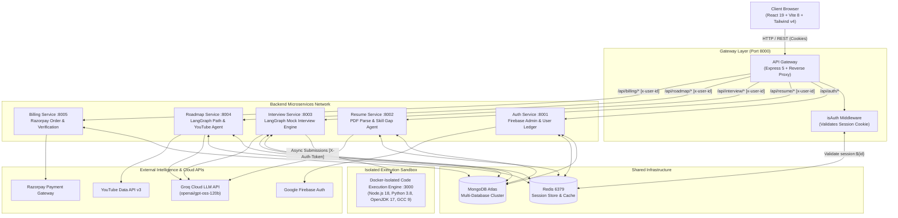
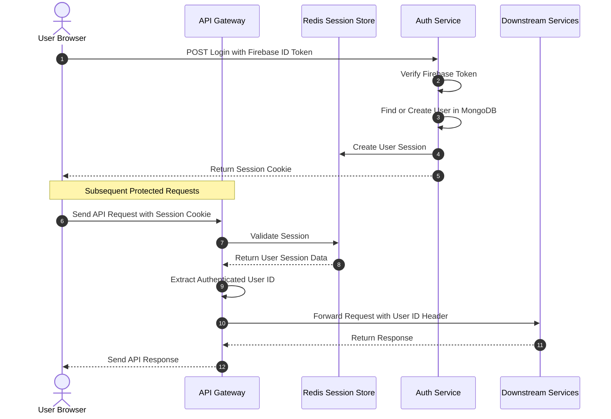
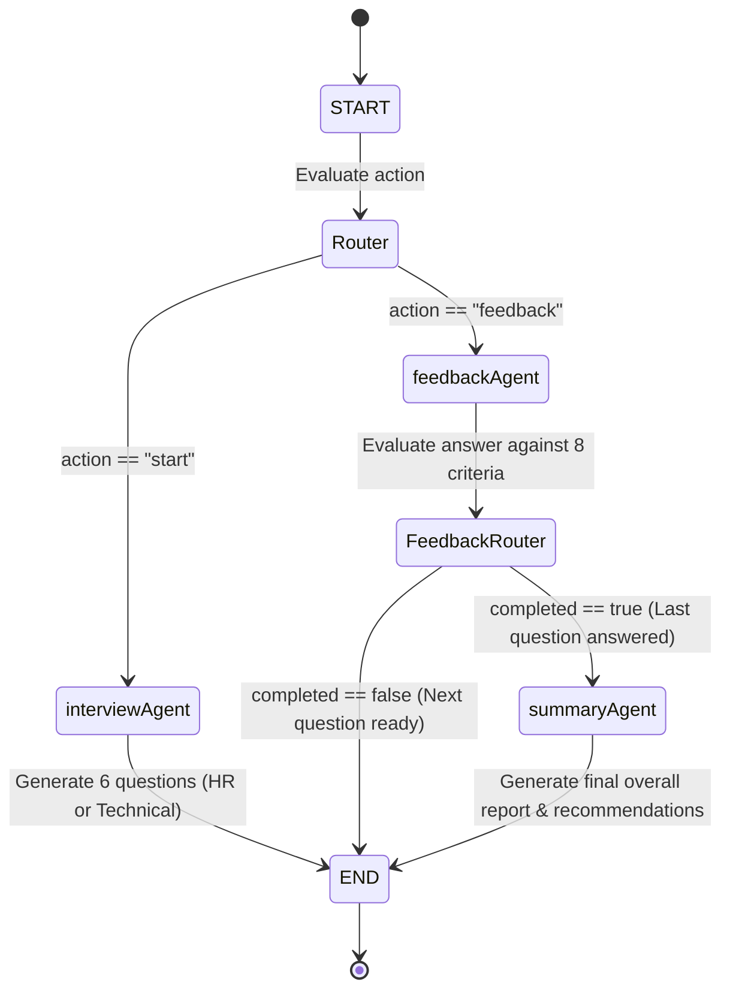
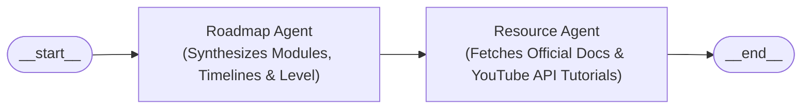

<div align="center">

  

# YUGAM (युगम्)

### _Next-Generation Autonomous AI Career Intelligence & Real-Time Interview Platform_

[](#system-architecture)
[](#frontend-client)
[](#microservices-deep-dive)
[](#ai--langgraph-agent-workflows)
[](#data-storage--redis-caching)
[](#billing-service-port-8005)
[](LICENSE)

<p align="center">
  <b>Yugam</b> is an enterprise-grade, microservices-driven AI career copilot designed to empower developers and job seekers. From automated <b>ATS resume scoring</b> and <b>intelligent curriculum generation with integrated YouTube/official documentation</b>, to <b>real-time conversational AI mock interviews</b> equipped with synchronized video avatars, voice synthesis, speech-to-text, and in-browser code execution—Yugam simulates the end-to-end tech hiring pipeline.
</p>

---

</div>

## 📑 Table of Contents

- [Executive Overview](#-executive-overview)
- [Key Features](#-key-features)
- [System Architecture](#-system-architecture)
  - [High-Level Topology](#high-level-topology)
  - [Gateway & Auth Flow](#gateway--auth-flow)
  - [AI Agent StateGraph Architecture](#ai-agent-stategraph-architecture)
- [Project Directory Structure](#-project-directory-structure)
- [Microservices Deep-Dive](#-microservices-deep-dive)
  - [1. API Gateway (`gateway`)](#1-api-gateway-port-8000)
  - [2. Authentication Service (`auth-service`)](#2-authentication-service-port-8001)
  - [3. Resume Intelligence Service (`resume`)](#3-resume-intelligence-service-port-8002)
  - [4. AI Mock Interview Service (`interview`)](#4-ai-mock-interview-service-port-8003)
  - [5. Roadmap & Resource Service (`roadmap`)](#5-roadmap--resource-service-port-8004)
  - [6. Billing & Subscription Service (`billing`)](#6-billing--subscription-service-port-8005)
- [Frontend Client (`frontend`)](#-frontend-client)
- [Token & Coin Economics](#-token--coin-economics)
- [API Reference Guide](#-api-reference-guide)
- [Data Storage & Redis Caching](#-data-storage--redis-caching)
- [Environment Variables Matrix](#-environment-variables-matrix)
- [Getting Started & Local Setup](#-getting-started--local-setup)
  - [Prerequisites](#prerequisites)
  - [Docker Setup (Redis)](#docker-setup-redis)
  - [Backend Services Launch](#backend-services-launch)
  - [Frontend Launch](#frontend-launch)
- [Security, Performance & Best Practices](#-security-performance--best-practices)
- [License & Contributors](#-license--contributors)

---

## 🌟 Executive Overview

Modern tech recruitment demands rigorous preparation, tailored resumes, structured roadmaps, and realistic technical evaluations. **Yugam** addresses this end-to-end lifecycle by orchestrating specialized microservices and AI agent graphs:

1. **Intelligent Resume Parsing & ATS Scoring**: Converts raw PDFs into structured entities (skills, experience, projects, education) using Groq-accelerated LLMs (`openai/gpt-oss-120b`), cross-referencing against predefined role taxonomies to spot skill gaps.
2. **Interactive Resume Builder**: Drag-and-drop / stepped builder creating ATS-optimized resumes with live previews and single-click PDF generation via `react-to-print`.
3. **Conversational Multi-Modal AI Interviewer**: Simulates real-world HR and Technical interviews. Features an interactive Monaco code editor, WebRTC camera preview, Web Speech API speech-to-text, real-time speech synthesis, and photorealistic AI video avatars.
4. **Autonomous Roadmap Generator**: Builds step-by-step career path modules benchmarked to salary targets (e.g., 20 LPA, 40 LPA), dynamically resolving official developer documentation and YouTube tutorials via the YouTube Data API v3.
5. **Gamified Virtual Credit Economy**: Built-in coin wallet with Razorpay integration for seamless credit purchasing and gated resource access.

---

## ✨ Key Features

| Domain                     | Features                                                                                                                                                                                                                                                                                                                                                             |
| :------------------------- | :------------------------------------------------------------------------------------------------------------------------------------------------------------------------------------------------------------------------------------------------------------------------------------------------------------------------------------------------------------------- |
| **Authentication**         | Firebase OAuth (Google popup/redirect), Redis-backed 7-day session store, secure HTTP-only cookies, automated session revocation on logout.                                                                                                                                                                                                                          |
| **API Gateway**            | Unified reverse proxy entrypoint (`express-http-proxy`), central authentication guard (`isAuth`), transparent header decoration (`x-user-id`).                                                                                                                                                                                                                       |
| **Resume Intelligence**    | PDF text parsing (`pdf-parse`), LangChain structured output extraction with dynamic AI domain detection (`suggestedRole`), deterministic ATS skill matching across 11+ tracks (including Cybersecurity & ML Engineering), clean `200 OK` empty-state handling, and ATS radial score meters (`recharts`).                                                             |
| **AI Mock Interview**      | LangGraph cyclic workflows, strict Technical vs. HR domain segregation, contextual resume-backed question synthesis, 8-dimensional evaluation (Correctness, Clarity, Relevance, Detail, Efficiency, Communication, Problem Solving, Creativity), comprehensive post-interview feedback report.                                                                       |
| **Interactive Studio**     | Embedded Monaco Code Editor (`@monaco-editor/react`), Docker-Isolated Multi-Language Code Execution Engine (JavaScript [Node.js 18], Python [3.8], Java [OpenJDK 17], C++ [GCC 9]), custom `stdin` terminal drawer, real-time `stdout`/`stderr`/compilation error diagnostics, candidate WebRTC camera stream, Web Speech voice input, video avatar synchronization. |
| **Targeted Roadmaps**      | 10 standardized engineering tracks (MERN Stack, Full-Stack, Java Backend, Frontend, Backend, Python Backend, QA Automation, DevOps, Data Analyst, ML Engineer), salary-bracketed milestones (10 to 40 LPA), dynamic resume attachment/replacement flow, automated official documentation resolution, YouTube Data API v3 video retrieval, Redis cached roadmaps.     |
| **Monetization & Billing** | Razorpay checkout, server-side HMAC-SHA256 signature verification, instant credit balance updates.                                                                                                                                                                                                                                                                   |

---

## 🏗️ System Architecture

### High-Level Topology



### Gateway & Auth Flow



### AI Agent StateGraph Architecture

#### 1. Interview Engine LangGraph Workflow



#### 2. Roadmap Generation Pipeline



---

## 📂 Project Directory Structure

```text
Yugam/
├── backend/
│   ├── docker-compose.yml              # Local container orchestration (Redis)
│   ├── package.json                    # Backend root dependencies (ioredis)
│   │
│   ├── gateway/                        # Reverse Proxy & Authentication Entrypoint (Port 8000)
│   │   ├── controllers/
│   │   │   └── user.controller.js      # /api/me handler
│   │   ├── middleware/
│   │   │   └── isAuth.js               # Redis session cookie verification
│   │   ├── utils/
│   │   │   └── proxyWithHeaders.js     # Downstream proxy with x-user-id header decoration
│   │   ├── index.js                    # Gateway Express application
│   │   ├── Dockerfile
│   │   └── package.json
│   │
│   ├── services/
│   │   ├── auth/                       # Port 8001: Firebase Auth & Session Management
│   │   │   ├── configs/                # DB (Mongoose) & Firebase Admin SDK configs
│   │   │   ├── controllers/            # Login, logout, coin credit/debit operations
│   │   │   ├── model/                  # User MongoDB Schema
│   │   │   ├── routes/                 # /login, /logout, /add-coins, /use-coins
│   │   │   ├── serviceAccountKey.json  # Firebase Admin private key
│   │   │   ├── index.js
│   │   │   ├── Dockerfile
│   │   │   └── package.json
│   │   │
│   │   ├── resume/                     # Port 8002: Resume Extraction & Role Skill Matcher
│   │   │   ├── agents/                 # resume.agent.js (LangChain structured parser with suggestedRole extraction)
│   │   │   ├── config/                 # Mongoose DB, Groq LLM, PDF extraction & roleSkills.js (11+ role profiles)
│   │   │   ├── controllers/            # uploadResume, getResume, getResumeRoles
│   │   │   ├── middleware/             # Multer temporary disk storage
│   │   │   ├── models/                 # Resume MongoDB schema (nested education, exp, projects)
│   │   │   ├── routes/                 # /upload, /get-resume, /roles
│   │   │   ├── utils/                  # skillMatcher.js (deterministic ATS scoring & dynamic custom role fallback)
│   │   │   ├── index.js
│   │   │   ├── Dockerfile
│   │   │   └── package.json
│   │   │
│   │   ├── interview/                  # Port 8003: LangGraph Conversational Interview Engine
│   │   │   ├── agents/                 # interview.agent.js, feedback.agent.js, summary.agent.js
│   │   │   ├── config/                 # DB & Groq LLM setup (openai/gpt-oss-120b)
│   │   │   ├── controllers/            # interview.controller.js & code.controller.js (isolated code runner)
│   │   │   ├── graph/                  # LangGraph StateGraph, nodes, and conditional routers
│   │   │   ├── models/                 # Interview schema with 8-dimensional scoring subdocument
│   │   │   ├── prompts/                # Strict domain segregation: hrInterviewPrompt.js, technicalInterviewPrompt.js
│   │   │   ├── routes/                 # interview.route.js (/code/run, /code/status/:token, /start, /answer, /all, /:id)
│   │   │   ├── utils/                  # codebox.js (runtime ID mappings & payload validation)
│   │   │   ├── index.js
│   │   │   ├── Dockerfile
│   │   │   └── package.json
│   │   │
│   │   ├── roadmap/                    # Port 8004: Career Roadmap & Learning Resource Engine
│   │   │   ├── agents/                 # roadmap.agent.js & resource.agent.js
│   │   │   ├── configs/                # DB, Groq LLM (6,000 max tokens), roadmap.prompt.js, youtube.js
│   │   │   ├── controllers/            # generateRoadmap, getAllRoadmap, getRoadmapbyId
│   │   │   ├── graph/                  # 2-stage LangGraph execution pipeline
│   │   │   ├── models/                 # Roadmap & nested Module MongoDB schemas
│   │   │   ├── routes/                 # /generate, /all, /:id
│   │   │   ├── index.js
│   │   │   ├── Dockerfile
│   │   │   └── package.json
│   │   │
│   │   └── billing/                    # Port 8005: Razorpay Checkout & Webhook Verification
│   │       ├── configs/                # DB & Razorpay instance configuration
│   │       ├── controllers/            # createOrder & verifyPayment (HMAC-SHA256 signature check)
│   │       ├── models/                 # Billing payment order schema
│   │       ├── routes/                 # /create, /verify
│   │       ├── index.js
│   │       ├── Dockerfile
│   │       └── package.json
│   │
│   └── shared/
│       └── redis/
│           └── redis.js                # Centralized ioredis client singleton
│
└── frontend/                           # React 19 Client SPA (Port 5173)
    ├── public/                         # Static assets
    ├── src/
    │   ├── apis/                       # Axios endpoints (user, resume, interview)
    │   ├── assets/                     # AI avatar video loops (male-ai.mp4, female-ai.mp4)
    │   ├── components/
    │   │   ├── interview/              # CodeEditor (Monaco + Terminal I/O), Timer, Step1setup, Step2interview, Step3report
    │   │   ├── resume/                 # ATSTemplate, PreviewResume, ResumeForm, DownloadBtn
    │   │   ├── roadmap/                # ModuleCard, RoadmapResult
    │   │   ├── InterviewGraph.jsx      # Radar & Bar visualizer for candidate metrics
    │   │   ├── LoginModel.jsx          # Firebase Google Authentication modal
    │   │   ├── PricingCard.jsx         # Coin purchase pricing card
    │   │   ├── Sidebar.jsx             # Collapsible modern application navigation
    │   │   └── Statbox.jsx             # Metric counter cards
    │   ├── pages/
    │   │   ├── Home.jsx                # Landing page with interactive hero
    │   │   ├── Dashboard.jsx           # Performance charts, recent interviews & stats
    │   │   ├── Scorer.jsx              # Resume upload, ATS score calculation, missing skills
    │   │   ├── ResumeBuilder.jsx       # 6-step wizard resume generator
    │   │   ├── InterviewStart.jsx      # Interview creation & coin deduction setup
    │   │   ├── InterviewPage.jsx       # Active interview arena (Camera, Avatar, STT, Code editor)
    │   │   ├── InterviewReport.jsx     # Post-interview audit report
    │   │   ├── Roadmap.jsx             # Interactive career roadmap generator
    │   │   └── Billing.jsx             # Coin top-up store with Razorpay checkout
    │   ├── redux/
    │   │   ├── resumeSlice.js          # Global client-side resume state
    │   │   └── store.js                # Redux Toolkit configuration
    │   ├── utils/
    │   │   ├── axios.js                # Axios pre-configured with withCredentials: true
    │   │   └── firebase.js             # Firebase client SDK initialization
    │   ├── App.jsx                     # Route declarations & persistent auth hydrate
    │   ├── main.jsx                    # Application entrypoint
    │   └── index.css                   # Global styles & Tailwind CSS v4 directives
    ├── vite.config.js                  # Vite bundler configuration
    └── package.json
```

---

## 🔬 Microservices Deep-Dive

### 1. API Gateway (Port 8000)

The central ingress controller for all client requests.

- **Reverse Proxy**: Utilizes `express-http-proxy` to route requests to upstream services without revealing downstream network ports.
- **Authentication Guard (`isAuth.js`)**:
  - Reads `session` cookie.
  - Interrogates Redis for `session:<sessionId>`.
  - Injects `req.user` payload into request context.
- **Identity Propagation (`proxyWithHeaders.js`)**: Decorates incoming HTTP requests with `x-user-id: <MongoObjectId>`, ensuring downstream services remain stateless regarding session storage.

### 2. Authentication Service (Port 8001)

Manages the user lifecycle and virtual coin balance.

- **Firebase Auth Bridge**: Decodes and verifies Firebase client ID tokens using `firebase-admin`.
- **User Upsert**: Automatically creates a record in MongoDB upon first login and assigns default starting credits (**150 Interview Coins**).
- **Session Provisioning**: Emits cryptographically secure session IDs via `crypto.randomUUID()`, caches session objects in Redis with a 7-day TTL (`60 * 60 * 24 * 7`), and writes a secure, `httpOnly`, `sameSite: "none"` cookie.
- **Coin Operations**:
  - `POST /use-coins`: Atomically checks balances and deducts credits for AI operations.
  - `POST /add-coins`: Credits user balances following successful Razorpay payment verifications.

### 3. Resume Intelligence Service (Port 8002)

Analyzes candidate resumes against target job profiles.

- **PDF Extraction**: Ingests multi-page PDFs using Multer disk buffering and parses textual streams via `pdf-parse`.
- **LangChain Structured Agent**: Prompts Groq LLM (`openai/gpt-oss-120b`) to convert raw text into a normalized schema comprising contact info, summary, education, technologies, experience, and projects.
- **AI-First Domain Extraction (`suggestedRole`)**: Automatically detects the candidate's authentic domain and career specialization (e.g. `Cybersecurity Analyst`, `ML Engineer`, `Cloud Architect`) directly from parsed resume text, eliminating hardcoded role fallbacks.
- **Deterministic Skill Gap Matcher (`roleSkills.js` & `skillMatcher.js`)**:
  - Evaluates extracted candidate skills against 11+ curated role profiles (MERN Stack, Full-Stack, Java Backend, Frontend, Backend, Python Backend, QA Automation, DevOps, Data Analyst, ML Engineer, and Cybersecurity Engineer).
  - Distinguishes between **Required Core Skills** and **Preferred Skills** with fuzzy alias matching.
  - Dynamically adapts to custom/unlisted domains without throwing runtime exceptions.
  - Calculates deterministic ATS compatibility scores (0–100%) and formulates targeted missing skill recommendations.
- **Clean Empty-State Handling**: For newly registered accounts without an uploaded resume, `GET /api/resume/get-resume` returns a graceful `200 OK` with `{ success: true, data: null, resume: null }` rather than an exceptional `404 Not Found`.
- **Caching**: Persists analyzed resume entities under Redis key `resume:<userId>` for sub-millisecond retrieval.
- **Resource Hygiene**: Automatically unlinks uploaded temporary PDF files from the local filesystem in a `finally` block.

### 4. AI Mock Interview Service (Port 8003)

Orchestrates autonomous, dynamic HR and Technical interviews.

- **LangGraph StateGraph Engine**:
  - **`interviewAgent`**: Generates 6 highly contextual, scenario-based interview questions tailored to the candidate's chosen role, difficulty level, and optional resume context.
  - **Strict Domain Segregation**:
    - **Technical Tracks**: Inforces 100% purely technical questions on Data Structures, Algorithms, System Design, Concurrency, Database Internals, and Framework Architecture (`technicalInterviewPrompt.js`).
    - **HR Tracks**: Enforces 100% behavioral, situational, culture fit, and conflict resolution questions using the STAR framework (`hrInterviewPrompt.js`).
  - **Resume Context Injection**: When `useResume: true`, dynamically formats and passes candidate project descriptions, tech stacks, experience, and growth areas directly into the interviewer prompt.
  - **`feedbackAgent`**: Evaluates individual responses against **8 rigorous dimensions**:
    1. _Correctness_
    2. _Clarity_
    3. _Relevance_
    4. _Detail_
    5. _Efficiency_
    6. _Communication_
    7. _Problem Solving_
    8. _Creativity_
  - **`summaryAgent`**: Triggered upon completion of the final question. Computes overall performance metrics, pinpoints explicit candidate strengths, analyzes weaknesses, and issues actionable study recommendations.
- **Docker-Isolated Multi-Language Code Execution Engine**:
  - Compiles and runs user code in an isolated sandbox supporting **JavaScript** (Node.js 18), **Python** (3.8), **Java** (OpenJDK 17 with `Main.java` entrypoint), and **C++** (GCC 9).
  - **Decoupled Workflow**: Clicking **"Run Code"** executes the solution and displays terminal output without submitting or advancing the interview question; **"Add To Answer"** appends formatted code to the active answer textarea.
  - **Interactive Terminal Drawer**: Monaco editor integrated with a bottom tabbed drawer providing custom standard input (`stdin`), real-time execution status badges (Accepted, Compilation Error, Runtime Error, Time Limit Exceeded), `stdout`, `stderr`, execution time (`time`), and memory telemetry (`memory`).
  - **Asynchronous Polling**: Submits execution jobs via `POST /code/run` and polls `GET /code/status/:token` every 400ms with a 20-second safety timeout.
  - **Zero Client Credential Exposure**: All sandbox traffic is proxied through the API Gateway, ensuring runner URLs and authentication secrets remain strictly internal.
- **Analytics Caching**: Caches user interview aggregations (`stats`, `technicalData`, `hrData`) under `interviews:<userId>` in Redis for 10 minutes, invalidating automatically upon submission of answers.

### 5. Roadmap & Resource Service (Port 8004)

Synthesizes end-to-end learning curriculums for career acceleration.

- **10 Standardized Engineering Tracks**: Fully supports MERN Stack Developer, Full-Stack Software Engineer, Java Backend Developer, Frontend Developer, Backend Developer, Python Backend Developer, QA Automation Engineer, DevOps Engineer, Data Analyst, and ML Engineer with salary-bracketed targets (10 LPA, 15 LPA, 20 LPA, 30 LPA, 40 LPA).
- **Two-Stage Sequential Pipeline**:
  - **Stage 1 (`roadmapAgent`)**: Analyzes target role, salary package tier, and user resume gaps to generate progressive learning modules categorized by timeline and difficulty (_Easy_, _Medium_, _Hard_). Configured with `maxTokens: 6000` to prevent JSON response truncation.
  - **Stage 2 (`resourceAgent`)**: Parses each module title, invokes the LLM to locate authoritative official documentation, and calls the **YouTube Data API v3** to retrieve matching video tutorials.
- **Resilient Fallbacks**: Seamlessly degrades to query-encoded fallback documentation and YouTube search links if external API rate limits or network hiccups occur, preventing roadmap generation failures.
- **Resume Replacement & Customization**: Features an interactive attachment and re-upload modal allowing candidates to swap resumes and re-align milestone recommendations.
- **Caching Strategy**: Roadmaps are cached in Redis under `roadmap:<id>` and `userRoadmaps:<userId>` for 1 hour (`3600s`).

### 6. Billing & Subscription Service (Port 8005)

Facilitates payment transactions and token replenishment.

- **Catalog Management**: Provides tiered plans (e.g., _Starter Plan_ at ₹199 for 300 Interview Coins).
- **Order Generation**: Invokes Razorpay SDK to create valid currency orders (`INR`).
- **Cryptographic Verification**: Re-computes and verifies HMAC-SHA256 signatures (`crypto.createHmac("sha256", secret)`) against `razorpay_order_id` and `razorpay_payment_id` to guarantee tamper-proof order settlements.

---

## 💻 Frontend Client

The frontend is a single-page application built with **React 19**, **Vite 8**, and **Tailwind CSS v4**:

- **Real-Time Speech Synthesis & Recognition**:
  - Integrated `webkitSpeechRecognition` captures candidate voice input and transcribes spoken answers in real-time.
  - Web Speech API synthesizes AI interviewer speech, coordinating video avatar playback (`male-ai.mp4` / `female-ai.mp4`).
- **Interactive Coding Sandbox**:
  - Integrated **Monaco Editor** (`@monaco-editor/react`) provides a VS Code-like coding workspace inside the interview arena, allowing candidates to write, edit, and submit code snippets directly to the AI interviewer.
- **Dynamic Visualizations**:
  - Interactive radar, bar, and radial charts (`recharts`, `react-circular-progressbar`) for tracking candidate skill trends across interview sessions.
- **ATS Resume Generator**:
  - 6-step form wizard managing personal information, summaries, technical skills, projects, employment history, and education. Includes instant ATS paper preview and single-click printing/PDF export (`react-to-print`).
- **State Management**:
  - **Redux Toolkit** (`resumeSlice.js`) manages cached resume state across tools.
  - Contextual user sessions automatically hydrate on app load via `GET /api/me`.

---

## 🪙 Token & Coin Economics

Yugam implements a virtual coin economy to balance LLM compute usage:

| Event / Action            |  Coin Impact   | Description                                                       |
| :------------------------ | :------------: | :---------------------------------------------------------------- |
| **New Account Creation**  | **+150 Coins** | Welcome bonus credited on first login.                            |
| **Resume ATS Scoring**    | **-10 Coins**  | Deducted when submitting a PDF for parsing and gap analysis.      |
| **Roadmap Generation**    | **-20 Coins**  | Deducted when compiling a custom curriculum with video resources. |
| **Start Mock Interview**  | **-50 Coins**  | Deducted when generating a full 6-question AI interview session.  |
| **Starter Plan Purchase** | **+300 Coins** | Credited on payment of ₹199 via Razorpay.                         |

---

## 📡 API Reference Guide

### Authentication (`/api/auth`)

| Method | Endpoint     | Description                                       | Headers / Auth | Payload                                        |
| :----- | :----------- | :------------------------------------------------ | :------------- | :--------------------------------------------- |
| `POST` | `/login`     | Authenticate with Firebase token & create session | None           | `{ "token": "<FirebaseIdToken>" }`             |
| `GET`  | `/logout`    | Invalidate Redis session & clear session cookie   | Cookie         | None                                           |
| `POST` | `/use-coins` | Deduct coins for an action                        | Cookie         | `{ "coins": 50, "action": "start-interview" }` |
| `POST` | `/add-coins` | Credit coins to user wallet                       | Cookie         | `{ "coins": 300 }`                             |

### User Profile (`/api`)

| Method | Endpoint | Description                              | Headers / Auth | Payload |
| :----- | :------- | :--------------------------------------- | :------------- | :------ |
| `GET`  | `/me`    | Get currently authenticated user profile | Session Cookie | None    |

### Resume Services (`/api/resume`)

| Method | Endpoint      | Description                                                                                                      | Headers / Auth | Payload                                                    |
| :----- | :------------ | :--------------------------------------------------------------------------------------------------------------- | :------------- | :--------------------------------------------------------- |
| `GET`  | `/roles`      | Fetch supported target job roles & taxonomy                                                                      | `x-user-id`    | None                                                       |
| `POST` | `/upload`     | Upload resume PDF & trigger ATS analysis                                                                         | `x-user-id`    | `FormData`: `resume` (PDF), `targetRole` (Optional String) |
| `GET`  | `/get-resume` | Retrieve user's parsed resume & gap analysis (returns `200 OK` with `{ data: null, resume: null }` if not found) | `x-user-id`    | None                                                       |

### AI Interview Engine (`/api/interview`)

| Method | Endpoint              | Description                                                   | Headers / Auth | Payload                                                                                       |
| :----- | :-------------------- | :------------------------------------------------------------ | :------------- | :-------------------------------------------------------------------------------------------- |
| `POST` | `/start`              | Start new interview session & generate questions              | `x-user-id`    | `{ "type": "technical"\|"hr", "role": "Frontend Developer", "useResume": true\|false }`       |
| `POST` | `/answer`             | Submit question response & get real-time feedback             | `x-user-id`    | `{ "interviewId": "...", "answer": "..." }`                                                   |
| `GET`  | `/all`                | Fetch user interview history, averages & radar metrics        | `x-user-id`    | None                                                                                          |
| `GET`  | `/:id`                | Fetch specific interview details and final report             | `x-user-id`    | None                                                                                          |
| `POST` | `/code/run`           | Submit source code to isolated execution sandbox              | `x-user-id`    | `{ "language": "javascript"\|"python"\|"java"\|"cpp", "source_code": "...", "stdin": "..." }` |
| `GET`  | `/code/status/:token` | Poll async execution status, stdout, stderr, errors & metrics | `x-user-id`    | None                                                                                          |

### Roadmaps & Learning Paths (`/api/roadmap`)

| Method | Endpoint    | Description                                                      | Headers / Auth | Payload                                                                                                                           |
| :----- | :---------- | :--------------------------------------------------------------- | :------------- | :-------------------------------------------------------------------------------------------------------------------------------- |
| `POST` | `/generate` | Build custom roadmap across 10 tracks with docs & YouTube videos | `x-user-id`    | `{ "role": "MERN Stack Developer", "targetPackage": "10 LPA"\|"15 LPA"\|"20 LPA"\|"30 LPA"\|"40 LPA", "useResume": true\|false }` |
| `GET`  | `/all`      | List all historical roadmaps created by the user                 | `x-user-id`    | None                                                                                                                              |
| `GET`  | `/:id`      | Fetch specific roadmap details by ID                             | `x-user-id`    | None                                                                                                                              |

### Billing & Orders (`/api/billing`)

| Method | Endpoint  | Description                                  | Headers / Auth | Payload                                                                                     |
| :----- | :-------- | :------------------------------------------- | :------------- | :------------------------------------------------------------------------------------------ |
| `POST` | `/create` | Create Razorpay order                        | `x-user-id`    | `{ "planId": "starter" }`                                                                   |
| `POST` | `/verify` | Validate cryptographic HMAC-SHA256 signature | `x-user-id`    | `{ "razorpay_order_id": "...", "razorpay_payment_id": "...", "razorpay_signature": "..." }` |

---

## 🗄️ Data Storage & Redis Caching

### MongoDB Collections

- `User`: Primary user identities, Firebase UIDs, emails, profile names, and live `interviewCoin` ledger balances.
- `Resume`: Full structured resume schemas including nested subdocuments for `education`, `experience`, `projects`, extracted skills, missing skills, and overall ATS scores.
- `Interview`: Interview metadata, chosen role, type, array of question subdocuments (questions, answers, timers, 8-metric scores), and aggregate final summary reports.
- `Roadmap`: Generated modular curriculums, target salaries, duration estimates, difficulty classifications, and resolved learning materials (YouTube URL, official doc link).
- `Billing`: Immutable transaction records documenting Razorpay order IDs, payment IDs, verification signatures, monetary amounts, and settlement statuses (`created`, `paid`, `failed`).

### Redis Key Patterns & Expiry Policies

| Key Pattern             | Purpose                                        | Lifetime (TTL)      | Invalidation Trigger                      |
| :---------------------- | :--------------------------------------------- | :------------------ | :---------------------------------------- |
| `session:<sessionId>`   | Holds authenticated user session JSON          | `7 days` (604,800s) | User logout / manual session revocation   |
| `resume:<userId>`       | Cached structured resume & ATS analysis        | Persistent (no TTL) | User re-uploads / updates resume          |
| `interviews:<userId>`   | Aggregated interview statistics & radar charts | `10 minutes` (600s) | New interview started or answer submitted |
| `roadmap:<id>`          | Cached individual roadmap entity               | `1 hour` (3600s)    | Cache expiry                              |
| `userRoadmaps:<userId>` | Array of all roadmaps belonging to user        | `1 hour` (3600s)    | Generation of a new roadmap               |

---

## 🔐 Environment Variables Matrix

To run the full Yugam stack, configure the following `.env` files across services:

### 1. Gateway (`backend/gateway/.env`)

```ini
PORT=8000
REDIS_URL="redis://localhost:6379"
AUTH_SERVICE_URL="http://localhost:8001"
RESUME_SERVICE_URL="http://localhost:8002"
INTERVIEW_SERVICE_URL="http://localhost:8003"
ROADMAP_SERVICE_URL="http://localhost:8004"
BILLING_SERVICE_URL="http://localhost:8005"
FRONTEND_URL="http://localhost:5173"
```

### 2. Auth Service (`backend/services/auth/.env`)

```ini
PORT=8001
MONGODB_URL="mongodb+srv://<username>:<password>@cluster.mongodb.net/user"
REDIS_URL="redis://localhost:6379"
```

_(Requires `backend/services/auth/serviceAccountKey.json` from Firebase Console)_

### 3. Resume Service (`backend/services/resume/.env`)

```ini
PORT=8002
MONGODB_URL="mongodb+srv://<username>:<password>@cluster.mongodb.net/resume"
REDIS_URL="redis://localhost:6379"
GROQ_API_KEY="gsk_..."
```

### 4. Interview Service (`backend/services/interview/.env`)

```ini
PORT=8003
MONGODB_URL="mongodb+srv://<username>:<password>@cluster.mongodb.net/interview"
REDIS_URL="redis://localhost:6379"
GROQ_API_KEY="gsk_..."
CODEBOX_URL="http://localhost:3000"
CODEBOX_AUTH_TOKEN="dev-token"
```

_(Internal execution engine running in an isolated Docker container on port 3000, authenticated via `CODEBOX_AUTH_TOKEN`)_

### 5. Roadmap Service (`backend/services/roadmap/.env`)

```ini
PORT=8004
MONGODB_URL="mongodb+srv://<username>:<password>@cluster.mongodb.net/Roadmap"
REDIS_URL="redis://localhost:6379"
GROQ_API_KEY="gsk_..."
YOUTUBE_API_KEY="AIzaSy..."
```

### 6. Billing Service (`backend/services/billing/.env`)

```ini
PORT=8005
MONGODB_URL="mongodb+srv://<username>:<password>@cluster.mongodb.net/Billing"
RAZORPAY_KEY_ID="rzp_test_..."
RAZORPAY_KEY_SECRET="jrdE..."
```

### 7. Frontend Client (`frontend/.env`)

```ini
VITE_BACKEND_URL="http://localhost:8000"
VITE_FIREBASE_APIKEY="AIzaSy..."
VITE_RAZORPAY_KEY_ID="rzp_test_..."
```

---

## 🚀 Getting Started & Local Setup

### Prerequisites

- [Node.js](https://nodejs.org/) `>= 20.x`
- [Docker & Docker Compose](https://www.docker.com/) (for Redis)
- [Git](https://git-scm.com/)
- Active API keys for **Groq Cloud**, **Firebase**, **YouTube Data API v3**, and **Razorpay** (Test Mode).

### Docker Setup (Redis)

From the `backend/` directory, spin up the Redis container:

```bash
cd backend
docker-compose up -d
```

Verify Redis is running on `localhost:6379`:

```bash
docker ps
```

### Backend Services Launch

Each microservice can be started in development mode using `nodemon`. Open separate terminal windows or run them concurrently:

```bash
# 1. API Gateway
cd backend/gateway
npm install
npm run dev

# 2. Auth Service
cd backend/services/auth
npm install
npm run dev

# 3. Resume Service
cd backend/services/resume
npm install
npm run dev

# 4. Interview Service
cd backend/services/interview
npm install
npm run dev

# 5. Roadmap Service
cd backend/services/roadmap
npm install
npm run dev

# 6. Billing Service
cd backend/services/billing
npm install
npm run dev
```

### Frontend Launch

Launch the React 19 development server:

```bash
cd frontend
npm install
npm run dev
```

Navigate to `http://localhost:5173` to access the application.

---

## 🛡️ Security, Performance & Best Practices

1. **Strict Session Isolation**: Sessions are identified by cryptographically unguessable UUIDs stored solely in Redis. Session cookies are delivered with `HttpOnly`, `SameSite=None`, and `Secure` attributes to prevent XSS-based session hijacking.
2. **Gateway-Enforced Identity**: Downstream microservices are inaccessible directly from the public web and require the trusted `x-user-id` header passed exclusively by the Gateway after verifying session authenticity.
3. **Cryptographic Payment Integrity**: Payment confirmations reject unverified client payloads. All transactions require strict server-side HMAC-SHA256 signature verification matching Razorpay secrets before credit top-ups are finalized.
4. **Resilient AI Extraction**: Prompts enforce JSON-only schemas with automatic cleanup filters (`replace(/```json/g, "").replace(/```/g, "").trim()`) to handle unexpected model outputs.
5. **Disk & Memory Hygiene**: Uploaded resume PDFs are immediately processed in memory/temporary disk storage and explicitly purged in `finally` execution blocks via `fs.promises.unlink`.
6. **Multi-Tier Cache Layering**: Expensive computational results (candidate career analytics, generated roadmaps, parsed resume trees) are cached in Redis to minimize unnecessary LLM token expenditure and optimize database queries.

---

## 📄 License & Contributors

### Creator & Lead Architect

- **Harsh Sharma** — Project Creator, System Architecture & Full-Stack Development

### License

This project is licensed under the terms of the [ISC License](LICENSE). See the [LICENSE](LICENSE) file for complete terms and copyright details.

---

<div align="center">
  <sub>Engineered with ❤️ by <b>Harsh Sharma</b>.</sub>
</div>
