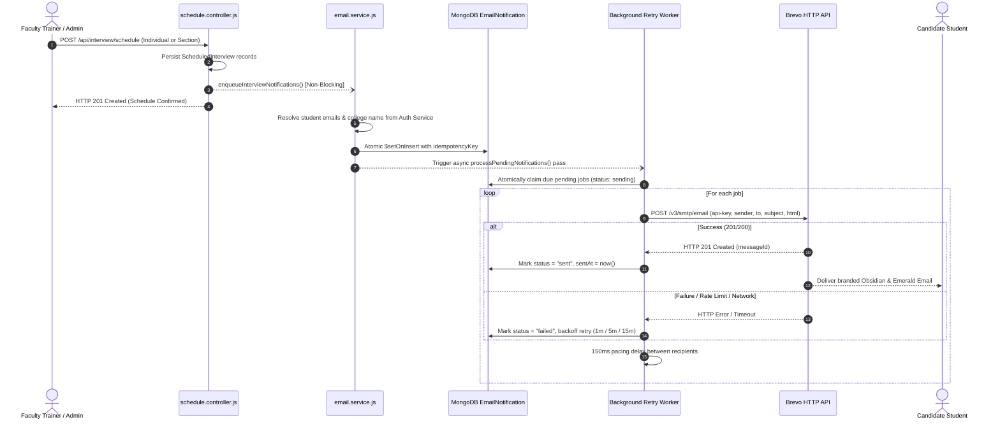
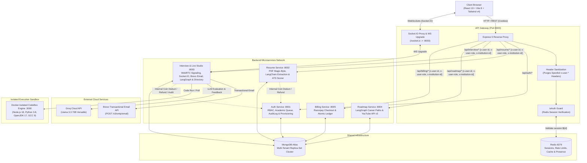
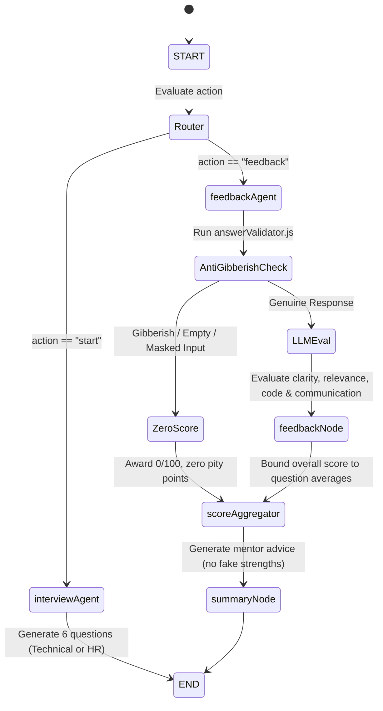

<div align="center">

  

# YUGAM (युगम्)

### _Institutional Placement, Assessment & Real-Time Live + AI Interview Platform_

[](#-system-architecture--microservices-topology)
[](#-frontend-client--design-system)
[](#-microservices-deep-dive)
[](#yugam-live-studio-candidate--interviewer-views)
[](#-automated-institutional-email-notifications-brevo-api)
[-brightgreen.svg)](#-automated-testing-suite-130-tests--45-suites)
[](#ai-interview--anti-gibberish-proctor-engine)
[](#-data-storage--redis-caching)
[](#6-billing--subscription-service-port-8005)
[](LICENSE)

<p align="center">
  <b>Yugam</b> is an enterprise-grade, multi-tenant B2B college placement and technical assessment ecosystem. Engineered for universities and technical academies, Yugam connects <b>College Placement Administrators</b>, <b>Technical Faculty Trainers</b>, and <b>Candidate Students</b> under a unified institutional hierarchy. It powers end-to-end placement readiness—from <b>verifiable 3-tier academic profiles</b> and <b>interactive split-screen career studios</b>, to <b>automated Brevo transactional email notifications</b>, <b>scheduled faculty-led WebRTC live video interviews</b> with real-time shared coding, and <b>proctored conversational AI mock interviews</b> with deterministic anti-gibberish scoring and domain competency tracking (DSA, Technical, Communication).
</p>

---

</div>

## 📑 Table of Contents

- [Executive Overview & Value Proposition](#-executive-overview--value-proposition)
- [Core Platform Capabilities (Role-by-Role)](#-core-platform-capabilities-role-by-role)
  - [1. Candidate Student Portal](#1-candidate-student-portal)
    - [Proctored AI Mock Interviews & Anti-Gibberish Proctor](#proctored-ai-mock-interviews--anti-gibberish-proctor)
    - [Yugam Live Studio (Candidate View) & Voice Transcription](#yugam-live-studio-candidate-view--voice-transcription)
    - [Interactive Split-Screen Resume Studio (`/resume`)](#interactive-split-screen-resume-studio-resume)
    - [ATS Resume Scorer Studio (`/scorer`)](#ats-resume-scorer-studio-scorer)
    - [AI Career Roadmap Studio (`/roadmap`)](#ai-career-roadmap-studio-roadmap)
    - [Verified 3-Tier Academic Background & Tasks](#verified-3-tier-academic-background--tasks)
  - [2. Technical Faculty Trainer Portal](#2-technical-faculty-trainer-portal)
    - [Yugam Live Studio (Interviewer View) & Voice Dictate](#yugam-live-studio-interviewer-view--voice-dictate)
    - [6-Criteria Live Candidate Evaluation Rubric](#6-criteria-live-candidate-evaluation-rubric)
    - [Live Interview Scheduling & Candidate Strengths/Improvements](#live-interview-scheduling--candidate-strengthsimprovements)
    - [Session Explorer & Redacted Private Notes](#session-explorer--redacted-private-notes)
  - [3. Placement Admin & Performance Directory](#3-placement-admin--performance-directory)
    - [Student Performance & Placement Directory](#student-performance--placement-directory)
    - [AI Domain Competencies (DSA, Technical, Communication)](#ai-domain-competencies-dsa-technical-communication)
    - [Advanced Filtering, Top-N Slicing & Formula-Safe Exports (CWE-1236)](#advanced-filtering-top-n-slicing--formula-safe-exports-cwe-1236)
    - [Institutional Governance, Bulk Provisioning & Last Admin Guard](#institutional-governance-bulk-provisioning--last-admin-guard)
- [Automated Institutional Email Notifications (Brevo API)](#-automated-institutional-email-notifications-brevo-api)
  - [Architecture & Transactional Event Flow](#architecture--transactional-event-flow)
  - [Branded Obsidian & Emerald Template Caliber](#branded-obsidian--emerald-template-caliber)
  - [Persistent Queue, Idempotency & Bounded Retry](#persistent-queue-idempotency--bounded-retry)
  - [Multi-Tenant Student Email & College Resolution](#multi-tenant-student-email--college-resolution)
- [System Architecture & Microservices Topology](#-system-architecture--microservices-topology)
  - [High-Level Microservices Architecture Diagram](#high-level-microservices-architecture-diagram)
  - [Microservices Port & Responsibility Table](#microservices-port--responsibility-table)
  - [Gateway Header Sanitization & Identity Propagation](#gateway-header-sanitization--identity-propagation)
  - [AI Agent StateGraph Architecture](#ai-agent-stategraph-architecture)
- [Security, Concurrency & Data Integrity Highlights](#-security-concurrency--data-integrity-highlights)
  - [1. 3-Tier Institutional RBAC & Tenant Isolation](#1-3-tier-institutional-rbac--tenant-isolation)
  - [2. Financial Atomicity & Idempotency](#2-financial-atomicity--idempotency)
  - [3. AI Evaluation Lease Fencing & Lock Ownership Tokens](#3-ai-evaluation-lease-fencing--lock-ownership-tokens)
  - [4. Socket.IO Presence & Peer State Tracking](#4-socketio-presence--peer-state-tracking)
  - [5. PII Redaction & Modernized Database Driver](#5-pii-redaction--modernized-database-driver)
- [Microservices Deep-Dive](#-microservices-deep-dive)
  - [1. API Gateway (`gateway` :8000)](#1-api-gateway-port-8000)
  - [2. Authentication & Governance Service (`auth` :8001)](#2-authentication--governance-service-port-8001)
  - [3. Resume Intelligence Service (`resume` :8002)](#3-resume-intelligence-service-port-8002)
  - [4. Interview & Live Studio Service (`interview` :8003)](#4-interview--live-studio-service-port-8003)
  - [5. Roadmap & Resource Service (`roadmap` :8004)](#5-roadmap--resource-service-port-8004)
  - [6. Billing & Subscription Service (`billing` :8005)](#6-billing--subscription-service-port-8005)
  - [7. Isolated Code Execution Engine (`codebox` :3000)](#7-isolated-code-execution-engine-port-3000)
- [Automated Testing Suite (130 Tests / 45 Suites)](#-automated-testing-suite-130-tests--45-suites)
- [Frontend Client & Design System](#-frontend-client--design-system)
- [Token & Coin Economics](#-token--coin-economics)
- [API Reference Guide](#-api-reference-guide)
- [Data Storage & Redis Caching](#-data-storage--redis-caching)
- [Environment Variables Matrix](#-environment-variables-matrix)
- [Getting Started & Local Setup](#-getting-started--local-setup)
  - [Option A — Local Multi-Terminal Workflow](#option-a--local-multi-terminal-workflow)
  - [Option B — Full Docker Compose Stack](#option-b--full-docker-compose-stack)
- [CI/CD Pipeline & Syntax Verification](#-cicd-pipeline--syntax-verification)
- [License & Contributors](#-license--contributors)

---

## 🌟 Executive Overview & Value Proposition

Modern university placement cells and corporate technical recruitment drives require more than generic practice chatbots. They demand a rigorous, audit-compliant institutional infrastructure that bridges verified academic backgrounds with live faculty evaluation, transactional notification tracking, and autonomous AI grading.

**Yugam** delivers this unified operational paradigm:

1. **Multi-Tenant Institutional Scoping**: All users, performance records, interview schedules, assignments, notifications, and audit logs are strictly scoped by `institutionId` (e.g. `"GLA_UNIVERSITY"`), dynamically resolving college identities across all portal headers and student communications.
2. **Tri-Role Institutional Hierarchy**: Dedicated capabilities for **Students** (practice, live assessments & studios), **Technical Faculty Trainers** (scheduling, live room conducting & rubric evaluation), and **College Placement Admins** (governance, academic verification, bulk provisioning & performance analytics).
3. **Automated Brevo Transactional Email Notifications**: Multi-tenant email dispatch system that reliably notifies students whenever faculty schedules, reschedules, or cancels an interview—complete with Asia/Kolkata date formatting, college name resolution, persistent queueing, and exponential backoff retry.
4. **Yugam Live Studio (`/live-interview/:scheduleId`)**: Low-latency peer-to-peer WebRTC video studio featuring authoritative Socket.IO room presence (`Peer Connected` vs. `Waiting for Peer...`), real-time question push with **Trainer Voice Dictation**, candidate speech-to-text transcription, synchronized Monaco code editor with multi-language isolated execution, and 6-criteria weighted rubric grading.
5. **AI Interview & Anti-Gibberish Proctor Engine**: Multi-turn LangGraph agent powered by Groq `llama-3.3-70b-versatile`, with real-time per-question grading, deterministic anti-gibberish proctor validation (`answerValidator.js` awarding `0/100` on nonsense answers), deterministic overall score aggregation, and downloadable PDF reports.
6. **AI Domain Competency Analytics (DSA, Technical, Communication)**: Automated question and rubric classification categorizing student performance into standard engineering competencies, powering an institutional directory with multi-metric sorting, **Top-N** cohort slicing, and **CWE-1236 spreadsheet injection-proof** exports.
7. **Interactive Career Studio Suite**: Split-screen studios in Yugam's White (`#F8F9FA`) and Obsidian (`#111318`) design caliber: **Resume Studio**, **ATS Resume Scorer Studio**, and **AI Career Roadmap Studio**.

---

## 👥 Core Platform Capabilities (Role-by-Role)

```text
┌───────────────────────────────────────────────────────────────────────────────────────────┐
│                                   YUGAM PLATFORM PORTAL                                   │
│            [ 🎓 Candidate Student ]    [ 👨‍🏫 Faculty Trainer ]    [ 🛡️ Placement Admin ]   │
├──────────────────────────────┬───────────────────────────────┬────────────────────────────┤
│ • Proctored AI Mock Interview│ • Live Video Studio (Trainer) │ • Performance Directory    │
│ • Yugam Live Studio (Student)│ • Real-Time Voice Dictate     │ • AI Domain Competencies   │
│ • Resume Studio (/resume)    │ • 6-Criteria Rubric Scoring   │ • Top-N Slicing & Exports  │
│ • Resume Scorer (/scorer)    │ • Strengths & Weaknesses Tags │ • Academic Verification    │
│ • Career Roadmap (/roadmap)  │ • Brevo Email Notifications   │ • Bulk User Provisioning   │
│ • 3-Tier Verified Academia   │ • Redacted Faculty Notes      │ • Immutable Audit Logs     │
│ • Tasks & Assignment Submits │ • Task Creation & Feedback    │ • Last Admin Security Guard│
└──────────────────────────────┴───────────────────────────────┴────────────────────────────┘
```

---

### 1. Candidate Student Portal

#### Proctored AI Mock Interviews & Anti-Gibberish Proctor
- **Conversational LangGraph Multi-Turn Flow**: Students engage in realistic 6-question simulated technical or HR interviews tailored to target role and experience tier.
- **Strict Anti-Gibberish Proctor Guard (`answerValidator.js`)**: Evaluates responses for minimum length, character entropy, vowel distribution, and repetition before invoking the LLM:
  - Random keyboard mashing (`"asdfjkl"`, `"rteyshj"`, `"wzxcg"`), pure numeric/symbol sequences (`"12345678"`, `"@#$%^&*"`), or blank entries receive strictly **`0/100`** with zero pity points (`clarity: 0`, `relevance: 0`, `communication: 0`).
  - Overall session score is mathematically bounded and coupled directly to question averages (`questions[].score`).
  - Eliminates hallucinated positive strengths when candidate answers are invalid (averages < 20).
- **Downloadable PDF Performance Reports**: Instant report generation detailing question-by-question candidate transcripts, model solutions, dimensional scores, and personalized mentor advice.

#### Yugam Live Studio (Candidate View) & Voice Transcription
- **P2P WebRTC Video Stage**: Ultra-low latency video/audio streaming with remote trainer tile and fallback avatar states.
- **Authoritative Socket Presence**: Top status bar indicates real-time connectivity (`Peer Connected` vs. `Waiting for Peer...`).
- **Live Response Canvas with Speech-to-Text**: Candidate speech is captured via the Web Speech API and transcribed in real time into the live answer workspace, synchronized to faculty in under `50ms`.
- **Shared Monaco Code Editor**: Real-time collaborative code editor with syntax highlighting and isolated sandboxed execution.

#### Interactive Split-Screen Resume Studio (`/resume`)
- **6-Step Interactive Stepper**: Personal Info, Professional Summary, Technical Skills, Work Experience, Projects, and Education.
- **Completeness Meter & Skill Tag Builder**: Visual percentage gauge and interactive chip categorization (`Languages`, `Frameworks`, `Databases`, `Tools`).
- **Live ATS A4 Preview**: Split-screen A4 canvas reflecting changes instantly with zoom controls (`75%`, `100%`, `125%`) and instant PDF export.

#### ATS Resume Scorer Studio (`/scorer`)
- **PDF Magic-Byte Verification**: Validates `%PDF-` file signature before parsing to neutralize disguised malicious binaries.
- **Benchmark Role Calibration**: Scores resumes against target engineering roles (`Frontend`, `Backend`, `Full Stack`, `DevOps`, `Data Science`).
- **Multidimensional Scoring Matrix**: Evaluates Content Relevance, Quantifiable Impact, ATS Keyword Density, Formatting, and Action Verbs.

#### AI Career Roadmap Studio (`/roadmap`)
- **LPA-Calibrated Curriculums**: Target tier selection calibrated to industry compensation brackets (`6-10 LPA`, `10-18 LPA`, `18-35 LPA`, `35+ LPA`).
- **Interactive Module Checklists**: Step-by-step topics with interactive progress checkoffs saved to user profile.
- **Verified Official Resources**: Curated official documentation links and relevant tutorial videos fetched via the YouTube Data API v3.

#### Verified 3-Tier Academic Background & Tasks
- **Discrete Metric Tracking**: Class 10th %, Class 12th %, and B.Tech CGPA maintained as distinct scales without misleading blending.
- **Institutional Verification Queue**: Student academic edits route to `pendingAcademicUpdate` awaiting official faculty approval.
- **Assignment Hub**: View deadlines, submit text or code solutions, and receive trainer evaluations.

---

### 2. Technical Faculty Trainer Portal

#### Yugam Live Studio (Interviewer View) & Voice Dictate
- **Trainer Cockpit**: Simultaneous view of candidate video feed, active code editor, question history, and rubric workspace.
- **Real-Time Voice Dictation**: Trainer can dictate interview questions or technical problem statements verbally via Speech-to-Text.
- **1-Click Starter Prompts**: Instantly inject pre-formulated problem prompts (`System Design`, `DSA / Complexity`, `Core Concepts`, `Debugging Scenario`).
- **Dynamic Question Push**: Push custom questions with difficulty badges (`Easy`, `Medium`, `Hard`) directly onto the candidate canvas.

#### 6-Criteria Live Candidate Evaluation Rubric
- **Comprehensive Dimensional Scoring**:
  1. `Problem Solving & Approach` (20%)
  2. `Code Quality & Clean Architecture` (20%)
  3. `Technical Knowledge & Fundamentals` (20%)
  4. `Communication & Articulation` (15%)
  5. `System Architecture & Scalability` (15%)
  6. `Debugging & Edge-Case Handling` (10%)
- **Session-Level Rubric Card**: Displays the calculated 6-dimensional aggregate alongside the overall evaluation score (`/100`).

#### Live Interview Scheduling & Candidate Strengths/Improvements
- **Targeted Scheduling**: Schedule individual candidate sessions or broadcast section-wide technical rounds (`targetType: SECTION`).
- **Candidate Strengths & Areas for Improvement**: Tag key student strengths and weaknesses with automatic pending input flush on submission.
- **Brevo Email Alerts**: Schedules automatically trigger branded notification emails with session timing, role, and guidance.

#### Session Explorer & Redacted Private Notes
- **Detailed Session Explorer**: Complete candidate response history, submitted code solutions, and dimensional AI criteria scores.
- **Confidential Faculty Notes**: `trainerPrivateNotes` field securely persisted for faculty/admin review and stripped from student payloads.

---

### 3. Placement Admin & Performance Directory

```text
┌────────────────────────────────────────────────────────────────────────────────────────────────────────┐
│ Student Performance & Placement Directory               [ 1 Enrolled ]     [ Export (.xlsx) ] [ Export (.csv) ]│
├────────────────────────────────────────────────────────────────────────────────────────────────────────┤
│ Harsh Sharma  ● Verified              ROLL: 2315000916   SEC: E   INTERVIEW AVG: 65.2/100   CGPA: 7.83 │
│ harshsharma257@gmail.com • B.Tech CSE                                                                  │
│ ┌────────────────────────────────────────────────────────────────────────────────────────────────────┐ │
│ │ 📖 VERIFIED ACADEMIC BACKGROUND:  10th: 94.5%  •  12th: 77.0%  •  B.Tech: 7.83 / 10 (Sem 7)        │ │
│ │ 🏆 INTERVIEW PERFORMANCE:         Overall: 65.2/100  •  AI Mock: 33.3/100  •  Live Trainer: 83.4/100│ │
│ │ 💻 AI DOMAIN COMPETENCIES:                                                                         │ │
│ │    DSA Score: 72/100               Technical Score: 80/100             Communication Score: 85/100 │ │
│ │    [████████████░░░░░░]            [███████████████░░░]                [█████████████████░]        │ │
│ └────────────────────────────────────────────────────────────────────────────────────────────────────┘ │
└────────────────────────────────────────────────────────────────────────────────────────────────────────┘
```

#### Student Performance & Placement Directory
- **Unified Scorecard**: Centralized institutional directory displaying cumulative interview score, live trainer average, AI mock average, discrete 3-tier academic records, and verified enrollment data.
- **Dynamic Metric Sorting**: Instant sorting across 7 performance vectors (`Avg. Interview Score`, `DSA Score`, `Technical Score`, `Communication Score`, `Current CGPA`, `Name`, `Roll Number`).

#### AI Domain Competencies (DSA, Technical, Communication)
- **Automatic Domain Classification (`domainClassifier.js`)**: Evaluates interview questions and rubric feedback into three core industry dimensions:
  - **DSA Score**: Algorithms, data structures, recursion, dynamic programming, complexity analysis, and submitted code.
  - **Technical Score**: Architecture, databases, APIs, microservices, backend concurrency, and core software engineering concepts.
  - **Communication Score**: Articulate expression, behavioral clarity, problem formulation, and structured explanation.
- **Domain Indicators**: Rendered inside student directory scorecards, report exports, and candidate transcripts.

#### Advanced Filtering, Top-N Slicing & Formula-Safe Exports (CWE-1236)
- **Cohort Slicing & Top N Filtering**: Numeric `Top N (e.g. 150)` input allows placement coordinators to identify the top N candidates across any active metric or section.
- **Formula-Sanitized Exports (`.xlsx` & `.csv`)**:
  - Automatically neutralizes dangerous spreadsheet formula prefixes (`=`, `+`, `-`, `@`, `\t`, `\r`) by prefixing with a single quote (`'`).
  - Prepend UTF-8 Byte Order Mark (`\uFEFF`) for clean Excel compatibility across international systems.
  - Includes candidate Roll Number, Name, Email, Section, 3-Tier Academics, Overall Score, Live Score, AI Score, **DSA Score**, **Technical Score**, and **Communication Score**.

#### Institutional Governance, Bulk Provisioning & Last Admin Guard
- **Academic Verification Queue**: Review and approve/reject student mark update requests with audit tracking.
- **Bulk User Provisioning**: CSV/JSON batch onboarding of hundreds of students or faculty in a single operation.
- **Last Admin Guard**: The platform strictly prohibits demoting or deactivating the last remaining administrator in an institution.
- **Immutable Institutional AuditLog**: Every administrative action is permanently recorded with actor identity, action type, timestamp, and metadata.

---

## 📧 Automated Institutional Email Notifications (Brevo API)

Yugam integrates an automated transactional email notification engine built directly into `backend/services/interview` utilizing the **Brevo Transactional Email HTTP API (`POST https://api.brevo.com/v3/smtp/email`)**.



### Architecture & Transactional Event Flow

- **Trigger Events**:
  1. **`INTERVIEW_SCHEDULED`**: Dispatched immediately upon scheduling an individual or section-wide round.
  2. **`INTERVIEW_RESCHEDULED`**: Dispatched automatically when session date/time is adjusted by faculty.
  3. **`INTERVIEW_CANCELLED`**: Dispatched when session status is set to `cancelled` or deleted by authorized faculty/admin.
- **Non-Blocking Architecture**: Scheduling HTTP requests never block or fail due to email delivery. `schedule.controller.js` enqueues notifications asynchronously and returns `201 Created` / `200 OK` instantly.

### Branded Obsidian & Emerald Template Caliber

- **Visual Caliber**: Templates match Yugam's White (`#F8F9FA`), Obsidian (`#111318`), and Emerald (`#10B981`) identity.
- **Dual Format**: Sends responsive HTML alongside clean plaintext fallbacks for standard email clients.
- **Timezone-Calibrated**: Timestamps formatted in `Asia/Kolkata` (`en-IN` standard with `IST` indicator).
- **XSS Sanitization**: All candidate names, role titles, and trainer instructions are sanitized via `escapeHtml()`.

### Persistent Queue, Idempotency & Bounded Retry

- **Deterministic Idempotency**: Jobs are indexed by unique key `${scheduledInterviewId}:${notificationType}:${version}` using MongoDB `$setOnInsert` upserts, preventing duplicate sends.
- **Atomic State Transitions**: Jobs transition atomically (`pending` -> `sending` -> `sent` / `failed`) using `findOneAndUpdate({ returnDocument: 'after' })`.
- **Bounded Exponential Backoff**: Failed deliveries retry on exponential intervals:
  - Attempt 1 failure: Retry in **`1 minute`**
  - Attempt 2 failure: Retry in **`5 minutes`**
  - Attempt 3 failure: Retry in **`15 minutes`**
  - Exceeding `maxAttempts: 3` halts further dispatch and records the error for auditing.
- **Rate Limit Protection**: Employs a `150ms` pacing delay between batch deliveries to respect API limits.
- **Recurring Worker**: An unref'd 60-second background interval (`setInterval`) retries pending or recovering notifications automatically.

### Multi-Tenant Student Email & College Resolution

- **Authoritative Directory Lookup**: Queries Auth Service (`/internal/institution/students`) filtered strictly by `institutionId`, rejecting foreign students to protect tenant boundaries.
- **College Name Resolution**: Extracts the student's actual college name (`GLA University Mathura`) from their profile, replacing raw tenant slugs (`DEFAULT_COLLEGE`) with graceful fallback to `"Institutional Placement Cell"`.
- **Resilient Fallback**: Falls back to `schedule.studentEmail` if Auth Service is temporarily restarting or unmocked.

---

## 🏗️ System Architecture & Microservices Topology

### High-Level Microservices Architecture Diagram



---

### Microservices Port & Responsibility Table

| Service | Port | Primary Stack | Key Responsibilities |
| :--- | :---: | :--- | :--- |
| **Frontend Client** | `5173` | React 19, Vite 8, Tailwind v4 | Responsive UI, WebRTC media, Monaco Editor, Split-Screen Studios |
| **API Gateway** | `8000` | Express 5, `http-proxy-middleware` | Ingress security, header sanitization, Redis session auth, Socket.IO upgrade |
| **Auth & Governance** | `8001` | Express 5, Mongoose, Firebase | User RBAC, 3-tier academic queue, bulk provisioning, immutable audit logs |
| **Resume Intelligence** | `8002` | Express 5, LangChain, Groq | PDF magic-byte validation, structured extraction, deterministic ATS scoring |
| **Interview & Live Studio** | `8003` | Express 5, Socket.IO, Brevo, LangGraph | WebRTC room signaling, Monaco sync, Brevo email queue, Student Directory |
| **Roadmap & Resource** | `8004` | Express 5, LangGraph, YouTube API | LPA-calibrated learning milestones, official docs, tutorial video discovery |
| **Billing & Wallet** | `8005` | Express 5, Razorpay SDK | Virtual coin wallet, Razorpay payment verification, idempotent settlement |
| **CodeBox Sandbox** | `3000` | Node.js, Docker isolated runner | Multi-language code execution (`JS`, `Python`, `Java`, `C++`) with rate limits |
| **Redis Cache & Store** | `6379` | Redis 7 Alpine | 7-day session store, rate-limiting counters, interview caching, pub/sub |
| **MongoDB Atlas** | `27017` | MongoDB Replica-Set (v7.0) | Multi-tenant persistent data with ACID cross-collection transactions |

---

### Gateway Header Sanitization & Identity Propagation

To guarantee that client requests cannot spoof user identity or elevate privileges:

```text
Incoming Request -> [ Strip x-user-* & x-gateway-secret ] -> [ Verify session:<id> in Redis ] -> [ Inject Server-Verified Headers ] -> Downstream Service
```

1. **Sanitization**: Gateway unconditionally deletes client-supplied `x-user-id`, `x-user-role`, `x-institution-id`, `x-user-name`, and `x-gateway-secret`.
2. **Session Verification**: Validates the session cookie against Redis (`session:<sessionId>`).
3. **Decoration**: Injects server-verified session headers before proxying requests downstream:
   - `x-user-id`: Verified MongoDB ObjectId.
   - `x-user-role`: `"student"` | `"trainer"` | `"admin"`.
   - `x-institution-id`: `"GLA_UNIVERSITY"` | `"DEFAULT_COLLEGE"`.
   - `x-user-name`: Full user display name.
   - `x-gateway-secret`: Pre-shared symmetric token preventing direct bypass.
4. **Role Enforcement (`requireRole`)**: Downstream microservices enforce endpoint access rules, returning `403 Forbidden` on unauthorized access attempts.

---

### AI Agent StateGraph Architecture

#### 1. Interview Engine LangGraph Workflow



---

## 🔒 Security, Concurrency & Data Integrity Highlights

### 1. 3-Tier Institutional RBAC & Tenant Isolation
- **Role Isolation**: Strict boundaries separate Student, Trainer, and Admin capabilities.
- **Tenant Scoping**: All queries filter by `institutionId`, preventing cross-college data access.
- **Role-Scoped UI Routing**: Interview creation buttons and administrative directories are role-guarded at both frontend route and backend middleware levels.

### 2. Financial Atomicity & Idempotency
- **ACID Double-Entry Transactions**: Coin deductions and top-ups execute inside MongoDB `withTransaction` blocks.
- **Unique Idempotency Keys**: Feature purchases and coin settlements are keyed to prevent duplicate deductions during network retries.

### 3. AI Evaluation Lease Fencing & Lock Ownership Tokens
- **Atomic Lease Fencing**: When a student submits an answer, the session is locked using an atomic `evaluationToken` with a 90-second expiration.
- **Concurrent Guard**: Concurrent submissions return `409 Conflict`, preventing double evaluation or race conditions.

### 4. Socket.IO Presence & Peer State Tracking
- **Authoritative Server Room State**: Tracks peer connection states via server-side room participant maps (`room:presence`).
- **Resilient Fallback**: Gracefully detects peer connectivity across single-machine testing tabs, restrictive NATs, and active WebRTC media negotiations.

### 5. PII Redaction & Modernized Database Driver
- **Sanitized Logging**: Dotenv banners suppressed via `{ quiet: true }`. Raw student email addresses, ObjectIds, and auth tokens are stripped from server logs.
- **Modern Mongoose Driver**: Replaced deprecated `{ new: true }` with `{ returnDocument: 'after' }` across all `findOneAndUpdate` operations.

---

## 🔬 Automated Testing Suite (130 Tests / 45 Suites)

The backend microservices ecosystem includes an automated native test suite (`node:test` + `node:assert/strict`) verifying security, authorization, anti-gibberish proctoring, email notifications, and data integrity:

```bash
npm test --prefix backend
```

```text
TAP version 13
# Subtest: 1. Spreadsheet Formula Injection Sanitization (CSV/Excel CWE-1236)
  ok 1 - Neutralizes dangerous leading characters by prefixing with single quote
  ok 2 - Leaves safe strings, numbers, and booleans untouched
  ok 3 - RFC 4180 CSV cell escaping properly handles commas, quotes, and sanitized formulas
  ok 4 - generateCsvString prepends UTF-8 BOM for Microsoft Excel compatibility
ok 1 - 1. Spreadsheet Formula Injection Sanitization (CSV/Excel CWE-1236)

# Subtest: 2. Student Performance Metric Aggregation & Non-Blending
  ok 1 - Computes overall, AI, and live averages only from completed interviews
  ok 2 - Maintains separate 3-tier academic indicators without blending percentage and CGPA
ok 2 - 2. Student Performance Metric Aggregation & Non-Blending

# Subtest: 3. RBAC on Performance Directory & Scheduling Endpoints
  ok 1 - Rejects student role attempting to access students directory (403 Forbidden)
  ok 2 - Allows trainer and admin roles to access students directory & scheduling
ok 3 - 3. RBAC on Performance Directory & Scheduling Endpoints

# Subtest: 4. Flexible Student Identifier Resolution (Email, Roll Number, MongoDB _id)
  ok 1 - Resolves student by exact Email (case-insensitive)
  ok 2 - Resolves student by University Roll Number (case-insensitive)
  ok 3 - Resolves student by MongoDB _id
  ok 4 - Returns undefined/404 for non-existent identifier
ok 4 - 4. Flexible Student Identifier Resolution (Email, Roll Number, MongoDB _id)

# Subtest: 5. Scheduled Interview Deletion Authorization & Scoping
  ok 1 - Allows assigned trainer to delete own scheduled interview
  ok 2 - Allows institution Admin to delete any scheduled interview
  ok 3 - Rejects unassigned trainer from deleting another trainer's session
  ok 4 - Rejects student role from deleting scheduled interview
  ok 5 - Rejects cross-institution scheduled interview deletion
ok 5 - 5. Scheduled Interview Deletion Authorization & Scoping

...

# Subtest: 21. Anti-Gibberish Proctor Validation & Deterministic Score Aggregation
  ok 1 - Flags gibberish, empty, or keyboard-mashed responses
  ok 2 - Generates 0-score feedback with zero pity points for gibberish
  ok 3 - Computes deterministic overallScore bounded to question averages
  ok 4 - Eliminates hallucinated strengths when average score is < 20
ok 34 - 21. Anti-Gibberish Proctor Validation & Deterministic Score Aggregation

# Subtest: 22. Real-Time Room Presence & Peer State Tracking
  ok 1 - Calculates authoritative room presence with verified participants
  ok 2 - Recalculates room presence upon socket disconnect or room exit
  ok 3 - Evaluates client-side isPeerConnected correctly across single-PC and WebRTC states
ok 35 - 22. Real-Time Room Presence & Peer State Tracking

# Subtest: 23. AI Domain Competency Evaluation, Top-N Slicing & Directory Export Validation
  ok 1 - evaluateDomainScores: accurately categorizes DSA, Technical, and Communication questions
  ok 2 - evaluateDomainScores: returns strictly 0 for all domains on zero score session
  ok 3 - Directory Top-N slicing and multi-criteria sorting by competency scores
  ok 4 - Export headers and rows include DSA, Technical, and Communication columns
ok 36 - 23. AI Domain Competency Evaluation, Top-N Slicing & Directory Export Validation

...

# Subtest: 24. Email Template Rendering & HTML Sanitization (XSS Prevention)
  ok 1 - escapeHtml neutralizes dangerous script tags, quotes, ampersands, and angle brackets
  ok 2 - formatDateTime formats dates correctly in specified timeZone (Asia/Kolkata default)
  ok 3 - renderInterviewNotificationEmail: INTERVIEW_SCHEDULED renders branded Obsidian & Emerald email
  ok 4 - renderInterviewNotificationEmail: INTERVIEW_RESCHEDULED renders updated schedule and subject
  ok 5 - renderInterviewNotificationEmail: INTERVIEW_CANCELLED renders cancellation notice without join urgency
ok 37 - 24. Email Template Rendering & HTML Sanitization (XSS Prevention)

# Subtest: 25. Brevo HTTP API Dispatch Validation (sendViaBrevo)
  ok 1 - Rejects missing or invalid recipient email addresses
  ok 2 - Gracefully skips dispatch when EMAIL_NOTIFICATIONS_ENABLED is not 'true'
  ok 3 - Gracefully skips dispatch when BREVO_API_KEY is missing
  ok 4 - Dispatches HTTP POST to Brevo API with valid payload and headers
  ok 5 - Throws descriptive error when Brevo API responds with HTTP 4xx or 5xx
ok 38 - 25. Brevo HTTP API Dispatch Validation (sendViaBrevo)

# Subtest: 26. Multi-Tenant Institution Isolation & Student Email Verification
  ok 1 - Filters out students belonging to foreign institutions
  ok 2 - Generates deterministic idempotency keys per schedule, type, and version
  ok 3 - Section scheduling fans out into independent notifications per student in section
ok 39 - 26. Multi-Tenant Institution Isolation & Student Email Verification

# Subtest: 27. Non-Blocking Scheduling Guarantee & Exponential Backoff Retry Logic
  ok 1 - Non-blocking guarantee: Controller schedule flow catches email notification errors without failing HTTP 201
  ok 2 - Exponential backoff retry calculation: 1m, 5m, 15m intervals with max 3 attempts
  ok 3 - Atomic state transition: pending -> sending -> sent marks providerMessageId and sentAt
ok 40 - 27. Non-Blocking Scheduling Guarantee & Exponential Backoff Retry Logic

# Subtest: 28. Diagnostic Delivery Logging & Student Email Resolution Fallback
  ok 1 - Logs '[EmailService] Skipped' when disabled or BREVO_API_KEY is unset without leaking secrets
  ok 2 - Logs '[EmailService] Delivery failed with HTTP' and sanitizes raw PII from console.error
  ok 3 - Renders student's actual college name and replaces DEFAULT_COLLEGE in email table and footer
  ok 4 - Falls back gracefully to 'Institutional Placement Cell' when college name is missing or raw slug
  ok 5 - Student email resolution falls back cleanly to schedule.studentEmail if Auth Service has no records
ok 41 - 28. Diagnostic Delivery Logging & Student Email Resolution Fallback

1..45
# tests 130
# suites 45
# pass 130
# fail 0
```

---

## 💻 Frontend Client & Design System

Built on **React 19**, **Vite 8**, and **Tailwind CSS v4**:

- **White & Obsidian Caliber**: Clean `#F8F9FA` canvas background paired with high-contrast `#111318` cards and vibrant pill badges.
- **Dynamic Institutional Branding**: Automatically resolves and renders college identities across all portal headers, student cards, and reports.
- **Speech Dictation & Synthesis**: Integrated browser Web Speech API for voice answer transcription and trainer question dictation.
- **Monaco Code Sandbox**: Embedded Monaco Editor with multi-language execution and terminal output.

---

## 🪙 Token & Coin Economics

| Action / Feature | Coin Impact | Description |
| :--- | :---: | :--- |
| **New Account Bonus** | **+150 Coins** | Welcome bonus credited upon initial signup. |
| **College-Sponsored Interview** | **0 Coins (Free)** | Fully sponsored by the institution placement cell. |
| **Resume ATS Scoring** | **-10 Coins** | Deduction for PDF parsing and skill gap evaluation. |
| **Resume PDF Download** | **-10 Coins** | Deducted upon exporting the formatted ATS resume. |
| **Roadmap Generation** | **-20 Coins** | Deduction for modular curriculum & resource discovery. |
| **Self-Paced AI Mock Interview**| **-50 Coins** | Deduction for 6-question conversational AI session. |
| **Starter Credit Pack** | **+300 Coins** | Top-up package purchased via Razorpay for ₹199. |

---

## 📡 API Reference Guide

### Authentication & Governance (`/api/auth`)

| Method | Endpoint | Description | Allowed Roles |
| :--- | :--- | :--- | :--- |
| `POST` | `/login` / `/signup` | Authenticate with Firebase token & establish 7-day session | Public |
| `GET` / `POST` | `/logout` | Invalidate Redis session & purge cookie | Authenticated |
| `PUT` | `/profile` | Update profile information (diverts CGPA to pending queue) | `student`, `trainer`, `admin` |
| `PATCH`| `/students/:id/verify-academics`| Approve or reject pending student academic marks | `trainer`, `admin` |
| `PATCH`| `/users/:targetUserId/role` | Update user role (enforces Last Admin Guard) | `admin` |
| `POST` | `/admin/provision-users` | Bulk onboard users via CSV / JSON | `admin` |
| `GET` | `/users` | List institution users with filtering | `trainer`, `admin` |
| `GET` | `/students/pending-verifications`| Fetch pending academic verification records | `trainer`, `admin` |
| `GET` | `/audit-logs` | Fetch immutable institutional audit trail | `admin` |

### Student Performance Directory & Exports (`/api/interview`)

| Method | Endpoint | Description | Allowed Roles |
| :--- | :--- | :--- | :--- |
| `GET` | `/students-directory` | Fetch paginated student directory with averages & domain scores | `trainer`, `admin` |
| `GET` | `/students-directory/export` | Export directory as formula-safe `.xlsx` or `.csv` (CWE-1236 hardened) | `trainer`, `admin` |

### Interview Scheduling & Email Dispatch (`/api/interview`)

| Method | Endpoint | Description | Allowed Roles |
| :--- | :--- | :--- | :--- |
| `POST` | `/schedule` | Schedule an AI or Live interview (Individual or Section) & enqueue email | `trainer`, `admin` |
| `GET` | `/schedule` | Fetch scheduled interviews for current user or institution | `student`, `trainer`, `admin` |
| `GET` | `/schedule/:id` | Fetch specific schedule details | `student`, `trainer`, `admin` |
| `PATCH`| `/schedule/:id/status` | Update scheduled session status (triggers reschedule/cancellation email) | `trainer`, `admin` |
| `DELETE`| `/schedule/:id` | Delete a scheduled interview session (triggers cancellation email) | `trainer`, `admin` |

### Live Video Interview Studio (`/api/interview`)

| Method | Endpoint | Description | Allowed Roles |
| :--- | :--- | :--- | :--- |
| `POST` | `/live/join/:scheduleId` | Authorize and join live video studio room | `student`, `trainer` |
| `POST` | `/live/:liveId/complete` | Finalize evaluation rubric and complete session | `trainer` |
| `POST` | `/live/:liveId/leave` | Leave live video studio and broadcast disconnect | `student`, `trainer`, `admin` |
| `GET` | `/live/by-schedule/:scheduleId`| Retrieve live room metadata by schedule ID | `student`, `trainer`, `admin` |
| `GET` | `/live/:liveId` | Fetch report (redacts `trainerPrivateNotes` for students) | `student`, `trainer`, `admin` |

### Tasks & Assignments (`/api/interview`)

| Method | Endpoint | Description | Allowed Roles |
| :--- | :--- | :--- | :--- |
| `POST` | `/tasks` | Create a new student assignment with deadline | `trainer`, `admin` |
| `GET` | `/tasks` | List assignments for current role | `student`, `trainer`, `admin` |
| `POST` | `/tasks/:taskId/submit` | Submit assignment solution (code/text) | `student` |
| `GET` | `/tasks/:taskId/submissions` | View all submissions for an assignment | `trainer`, `admin` |
| `PATCH`| `/tasks/:taskId/submissions/:subId` | Grade submission and leave feedback | `trainer`, `admin` |

### AI Mock Interview Engine & Code Runner (`/api/interview`)

| Method | Endpoint | Description | Allowed Roles |
| :--- | :--- | :--- | :--- |
| `POST` | `/start` | Deduct 50 coins & start 6-question AI mock interview | `student` |
| `POST` | `/answer` / `/submit` | Submit answer with optimistic concurrency locking & token lease | `student` |
| `GET` | `/all` | Fetch interview history, scores, and questions solved | Authenticated |
| `GET` | `/:id` | Fetch specific interview report (redacts notes for students) | Authenticated |
| `POST` | `/code/run` | Submit source code to CodeBox sandbox (15 runs/min limit) | Authenticated |
| `GET` | `/code/status/:token` | Poll async code execution output | Authenticated |

### Resume Intelligence (`/api/resume`)

| Method | Endpoint | Description | Allowed Roles |
| :--- | :--- | :--- | :--- |
| `GET` | `/roles` | Fetch supported job roles and taxonomy | Authenticated |
| `POST` | `/upload` | Upload resume PDF (`%PDF-` verified) & compute ATS score | Authenticated |
| `GET` | `/get-resume` | Fetch parsed resume & gap analysis (200 OK empty state) | Authenticated |

### Career Roadmaps (`/api/roadmap`)

| Method | Endpoint | Description | Allowed Roles |
| :--- | :--- | :--- | :--- |
| `POST` | `/generate` | Generate modular curriculum with docs & YouTube videos | Authenticated |
| `GET` | `/all` | List all roadmaps created by user | Authenticated |
| `GET` | `/:id` | Fetch specific roadmap details | Authenticated |

### Billing & Subscription (`/api/billing`)

| Method | Endpoint | Description | Allowed Roles |
| :--- | :--- | :--- | :--- |
| `POST` | `/create` | Create Razorpay order for authenticated user | Authenticated |
| `POST` | `/verify` | Verify HMAC-SHA256 signature and settle credits | Authenticated |

---

## 🗄️ Data Storage & Redis Caching

### MongoDB Collections
- `User`: User profiles, Firebase UIDs, emails, roles (`student`, `trainer`, `admin`), `institutionId`, verified academia, and `pendingAcademicUpdate`.
- `ScheduledInterview`: Scheduled AI and Live sessions with target type (`INDIVIDUAL` vs `SECTION`), assigned trainer, candidate, college name, and date/time.
- `EmailNotification`: Persistent transactional email queue tracking `idempotencyKey`, recipient, notification type, status, retry counts, and Brevo message IDs.
- `LiveInterview`: Live room sessions, WebRTC signaling metadata, dynamic questions pushed, 6-criteria rubric scores, strengths/weaknesses, summary feedback, domain scores, and confidential `trainerPrivateNotes`.
- `Task`: Assignment definitions, target courses, deadlines, and submission records with grades and feedback.
- `AuditLog`: Immutable audit trail documenting administrative role updates, academic approvals, bulk user imports, and directory exports.
- `CoinTransaction`: Immutable double-entry virtual credit ledger tracking credits, deductions, and refunds with unique idempotency keys.
- `Resume`: Structured resume entities (skills, experience, education, suggested role, and ATS scores).
- `Interview`: Conversational AI mock interview records, questions, responses, 8-dimensional scores, domain scores, and final reports.
- `Roadmap`: Structured learning modules, difficulty tiers, documentation links, and YouTube tutorials.
- `Billing`: Razorpay orders, payment signatures, and transaction settlement records.

### Redis Key Patterns & Expiry Policies

| Key Pattern | Purpose | Lifetime (TTL) | Invalidation Trigger |
| :--- | :--- | :--- | :--- |
| `session:<sessionId>` | Holds authenticated user session JSON | `7 days` (604,800s) | Logout / session revocation |
| `resume:<userId>` | Cached structured resume & ATS analysis | Persistent | Resume update / re-upload |
| `interviews:<userId>` | Aggregated interview statistics & radar charts | `10 minutes` (600s) | New interview completed |
| `roadmap:<userId>:<roadmapId>` | Cached individual roadmap entity | `1 hour` (3,600s) | Expiry |
| `userRoadmaps:<userId>` | List of all user roadmaps | `1 hour` (3,600s) | New roadmap generated |
| `codebox:token:<token>` | Binds execution token to user ownership | `1 hour` (3,600s) | Expiry |
| `ratelimit:code:<userId>` | Enforces sliding rate limit of 15 runs/min | `60 seconds` | Window reset |

---

## 🔐 Environment Variables Matrix

### `backend/.env` (Root Compose Configuration)

```ini
GATEWAY_INTERNAL_SECRET="yugam-gateway-internal-secret-key-2026"
INTERNAL_SERVICE_SECRET="yugam-internal-service-secret-key-2026"

MONGODB_URL_AUTH="mongodb+srv://<username>:<password>@cluster.mongodb.net/user"
MONGODB_URL_RESUME="mongodb+srv://<username>:<password>@cluster.mongodb.net/resume"
MONGODB_URL_INTERVIEW="mongodb+srv://<username>:<password>@cluster.mongodb.net/interview"
MONGODB_URL_ROADMAP="mongodb+srv://<username>:<password>@cluster.mongodb.net/Roadmap"
MONGODB_URL_BILLING="mongodb+srv://<username>:<password>@cluster.mongodb.net/Billing"

GROQ_API_KEY="gsk_..."
YOUTUBE_API_KEY="AIzaSy..."
RAZORPAY_KEY_ID="rzp_test_..."
RAZORPAY_KEY_SECRET="jrdE..."

CODEBOX_URL="http://host.docker.internal:3000"
CODEBOX_AUTH_TOKEN="your_codebox_token"
FRONTEND_URL="http://localhost:5173"

# Brevo Transactional Email Notifications
EMAIL_NOTIFICATIONS_ENABLED=true
BREVO_API_KEY="xkeysib-..."
EMAIL_FROM_ADDRESS="notifications@yugam.io"
EMAIL_FROM_NAME="Yugam"
EMAIL_TIMEZONE="Asia/Kolkata"
```

### `frontend/.env`

```ini
VITE_BACKEND_URL="http://localhost:8000"
VITE_FIREBASE_APIKEY="AIzaSy..."
VITE_RAZORPAY_KEY_ID="rzp_test_..."
```

---

## 🚀 Getting Started & Local Setup

### Prerequisites

- [Node.js](https://nodejs.org/) `>= 20.x`
- [Docker Desktop](https://www.docker.com/) (for Redis and containerized microservices)
- [Git](https://git-scm.com/)
- Active API keys for **Groq Cloud**, **Firebase Admin**, **Brevo** (for email alerts), **YouTube Data API v3**, and **Razorpay** (Test Mode).

---

### Option A — Local Multi-Terminal Workflow

#### 1. Start Redis
```bash
docker compose -f backend/docker-compose.yml up -d redis
```

#### 2. Start Microservices in Separate Terminals
```bash
# Terminal 1 — API Gateway (Port 8000)
cd backend/gateway && npm install && npm run dev

# Terminal 2 — Auth Service (Port 8001)
cd backend/services/auth && npm install && npm run dev

# Terminal 3 — Resume Service (Port 8002)
cd backend/services/resume && npm install && npm run dev

# Terminal 4 — Interview Service (Port 8003)
cd backend/services/interview && npm install && npm run dev

# Terminal 5 — Roadmap Service (Port 8004)
cd backend/services/roadmap && npm install && npm run dev

# Terminal 6 — Billing Service (Port 8005)
cd backend/services/billing && npm install && npm run dev
```

#### 3. Start Frontend Client
```bash
cd frontend && npm install && npm run dev
```
Open [http://localhost:5173](http://localhost:5173) in your browser.

---

### Option B — Full Docker Compose Stack

Run the entire microservices cluster in containerized mode:

```bash
docker compose -f backend/docker-compose.yml up -d --build
```

To tail logs across all microservices:
```bash
docker compose -f backend/docker-compose.yml logs -f
```

---

## 🚦 CI/CD Pipeline & Syntax Verification

The repository enforces strict verification gates across both backend and frontend:

### 1. Backend Syntax & Security Regression Gate
```bash
# 1. Syntax check all backend JavaScript files
find backend -name "*.js" -not -path "*/node_modules/*" -exec node --check {} +

# 2. Run full backend test suite (130 tests / 45 suites)
npm test --prefix backend
```

### 2. Frontend Production Build Gate
```bash
npm run build --prefix frontend
```

---

## 📄 License & Contributors

### Creator & Lead Architect

- **Harsh Sharma** — Project Creator, System Architecture & Full-Stack Development

### License

This project is licensed under the terms of the [ISC License](LICENSE). See the [LICENSE](LICENSE) file for complete details.

---

<div align="center">
  <sub>Engineered with ❤️ for institutional placement excellence by <b>Harsh Sharma</b>.</sub>
</div>
