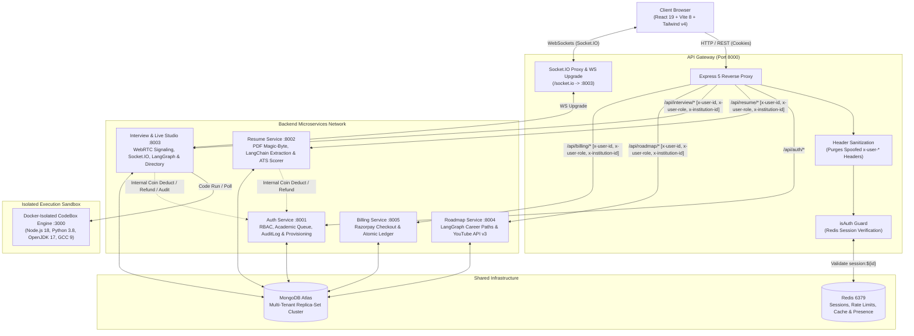
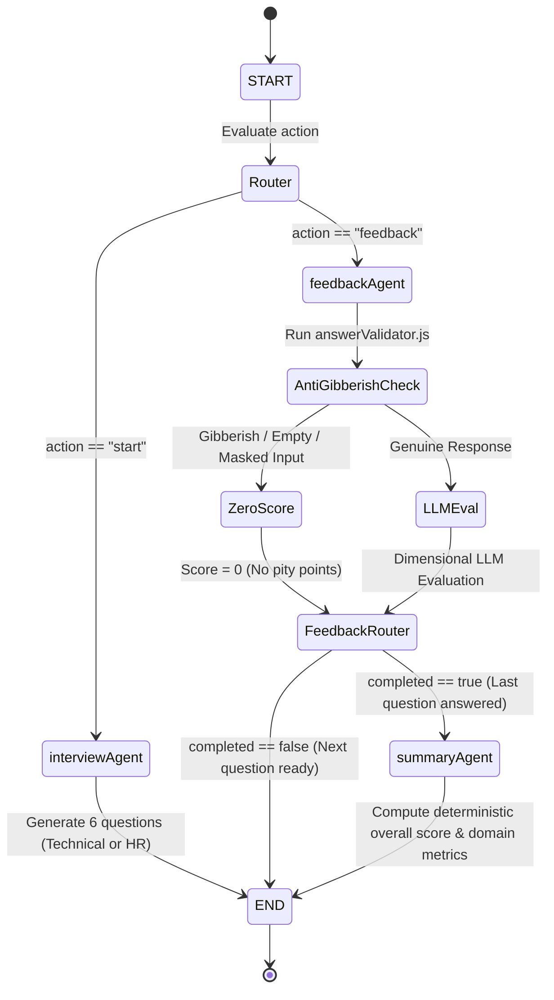
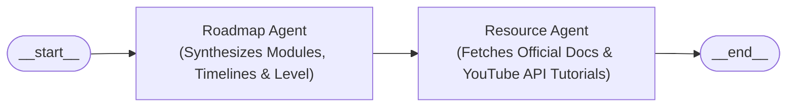

<div align="center">

  

# YUGAM (युगम्)

### _Institutional Placement, Assessment & Real-Time Live + AI Interview Platform_

[](#-system-architecture--microservices-topology)
[](#frontend-client)
[](#microservices-deep-dive)
[](#yugam-live-studio-candidate--interviewer-views)
[-brightgreen.svg)](#-automated-testing-suite-109-tests--40-suites)
[](#ai-interview--anti-gibberish-proctor-engine)
[](#-data-storage--redis-caching)
[](#6-billing--subscription-service-port-8005)
[](LICENSE)

<p align="center">
  <b>Yugam</b> is an enterprise-grade, multi-tenant B2B college placement and technical assessment ecosystem. Engineered for universities and tech academies, Yugam connects <b>College Placement Administrators</b>, <b>Technical Faculty Trainers</b>, and <b>Candidate Students</b> under a unified institutional hierarchy. It powers end-to-end placement readiness—from <b>verifiable 3-tier academic profiles</b> and <b>interactive split-screen career studios</b>, to <b>scheduled faculty-led WebRTC live video interviews</b> with real-time shared coding, and <b>proctored conversational AI mock interviews</b> with deterministic anti-gibberish scoring.
</p>

---

</div>

## 📑 Table of Contents

- [Executive Overview & Value Proposition](#-executive-overview--value-proposition)
- [Core Platform Capabilities (Role-by-Role)](#-core-platform-capabilities-role-by-role)
  - [1. Candidate Student Portal](#1-candidate-student-portal)
    - [Proctored AI Mock Interviews & Anti-Gibberish Proctor](#proctored-ai-mock-interviews--anti-gibberish-proctor)
    - [Yugam Live Studio (Candidate View)](#yugam-live-studio-candidate-view)
    - [Interactive Split-Screen Resume Studio (`/resume`)](#interactive-split-screen-resume-studio-resume)
    - [ATS Resume Scorer Studio (`/scorer`)](#ats-resume-scorer-studio-scorer)
    - [AI Career Roadmap Studio (`/roadmap`)](#ai-career-roadmap-studio-roadmap)
    - [Verified 3-Tier Academic Background & Tasks](#verified-3-tier-academic-background--tasks)
  - [2. Technical Faculty Trainer Portal](#2-technical-faculty-trainer-portal)
    - [Yugam Live Studio (Interviewer View) & Voice Dictate](#yugam-live-studio-interviewer-view--voice-dictate)
    - [6-Criteria Live Candidate Evaluation Rubric](#6-criteria-live-candidate-evaluation-rubric)
    - [Live Interview Scheduling & Session Explorer](#live-interview-scheduling--session-explorer)
  - [3. Placement Admin & Performance Directory](#3-placement-admin--performance-directory)
    - [Student Performance & Placement Directory](#student-performance--placement-directory)
    - [AI Domain Competencies (DSA, Technical, Communication)](#ai-domain-competencies-dsa-technical-communication)
    - [Advanced Filtering, Top-N Slicing & Formula-Safe Exports (CWE-1236)](#advanced-filtering-top-n-slicing--formula-safe-exports-cwe-1236)
    - [Institutional Governance, Bulk Provisioning & Last Admin Guard](#institutional-governance-bulk-provisioning--last-admin-guard)
- [System Architecture & Microservices Topology](#-system-architecture--microservices-topology)
  - [High-Level Microservices Architecture Diagram](#high-level-microservices-architecture-diagram)
  - [Microservices Port & Responsibility Table](#microservices-port--responsibility-table)
  - [Gateway Header Sanitization & Identity Propagation](#gateway-header-sanitization--identity-propagation)
  - [AI Agent StateGraph Architecture](#ai-agent-stategraph-architecture)
- [Security, Concurrency & Data Integrity Highlights](#-security-concurrency--data-integrity-highlights)
  - [1. 3-Tier Institutional RBAC & Tenant Isolation](#1-3-tier-institutional-rbac--tenant-isolation)
  - [2. Financial Atomicity & Idempotency](#2-financial-atomicity--idempotency)
  - [3. AI Evaluation Lease Fencing & Lock Ownership Tokens](#3-ai-evaluation-lease-fencing--lock-ownership-tokens)
  - [4. Socket.IO & Export Hardening](#4-socketio--export-hardening)
- [Microservices Deep-Dive](#-microservices-deep-dive)
  - [1. API Gateway (`gateway` :8000)](#1-api-gateway-port-8000)
  - [2. Authentication & Governance Service (`auth` :8001)](#2-authentication--governance-service-port-8001)
  - [3. Resume Intelligence Service (`resume` :8002)](#3-resume-intelligence-service-port-8002)
  - [4. Interview & Live Studio Service (`interview` :8003)](#4-interview--live-studio-service-port-8003)
  - [5. Roadmap & Resource Service (`roadmap` :8004)](#5-roadmap--resource-service-port-8004)
  - [6. Billing & Subscription Service (`billing` :8005)](#6-billing--subscription-service-port-8005)
  - [7. Isolated Code Execution Engine (`codebox` :3000)](#7-isolated-code-execution-engine-port-3000)
- [Automated Testing Suite (109 Tests / 40 Suites)](#-automated-testing-suite-109-tests--40-suites)
- [Frontend Client & Design System](#-frontend-client--design-system)
- [Token & Coin Economics](#-token--coin-economics)
- [API Reference Guide](#-api-reference-guide)
- [Data Storage & Redis Caching](#-data-storage--redis-caching)
- [Environment Variables Matrix](#-environment-variables-matrix)
- [Getting Started & Local Setup](#-getting-started--local-setup)
  - [Option A — Local Multi-Terminal Workflow](#option-a--local-multi-terminal-workflow)
  - [Option B — Full Docker Compose Stack](#option-b--full-docker-compose-stack)
- [CI/CD Pipeline & Syntax Verification](#-cicd-pipeline--syntax-verification)
- [License & Contributors](#-license--contributors)

---

## 🌟 Executive Overview & Value Proposition

Modern college placement cells and corporate technical recruitment drives require more than generic chatbot practice. They demand a rigorous, audit-compliant institutional infrastructure that bridges verified academic records with live technical evaluation and autonomous AI assessment.

**Yugam** delivers this unified operational paradigm:

1. **Multi-Tenant Institutional Scoping**: All users, performance records, interview schedules, assignments, and audit logs are strictly scoped by `institutionId` (e.g. `"DEFAULT_COLLEGE"`, `"GLA_UNIVERSITY"`), dynamically resolving college identities across all portal headers and reports.
2. **Tri-Role Institutional Hierarchy**: Dedicated capabilities for **Students** (practice & assessment), **Technical Faculty Trainers** (scheduling, live evaluation & grading), and **College Placement Admins** (governance, verification, provisioning & audit logs).
3. **Yugam Live Studio (`/live-interview/:scheduleId`)**: Low-latency peer-to-peer WebRTC video studio featuring Socket.IO room signaling, real-time question push with **Voice Dictate**, browser Speech-to-Text dictation, synchronized Monaco code editor with multi-language isolated execution, and weighted rubric grading.
4. **AI Interview & Anti-Gibberish Proctor Engine**: Multi-turn LangGraph agent powered by Groq `llama-3.3-70b-versatile`, with real-time per-question grading, deterministic anti-gibberish validation (`answerValidator.js` awarding `0/100` on nonsense answers), deterministic overall score aggregation, and downloadable PDF reports.
5. **Verifiable Academic Directory & Injection-Proof Exports**: Comprehensive performance tracking that keeps Class 10th %, Class 12th %, and B.Tech CGPA as discrete, verified indicators. Full-dataset Excel (`.xlsx`) and CSV (`.csv`) exports hardened against **CWE-1236 spreadsheet formula injection**.
6. **Career Studio Suite**: Interactive split-screen studios in Yugam's White (`#F8F9FA`) and Obsidian (`#111318`) caliber: **Resume Studio**, **ATS Resume Scorer Studio**, and **AI Career Roadmap Studio**.

---

## 👥 Core Platform Capabilities (Role-by-Role)

```text
┌───────────────────────────────────────────────────────────────────────────────────────────┐
│                                   YUGAM PLATFORM PORTAL                                   │
│            [ 🎓 Candidate Student ]    [ 👨‍🏫 Faculty Trainer ]    [ 🛡️ Placement Admin ]   │
├──────────────────────────────┬───────────────────────────────┬────────────────────────────┤
│ • Proctored AI Mock Sessions │ • Yugam Live Studio Host      │ • Institutional Governance │
│ • Yugam Live Studio Peer     │ • Live Question Voice Dictate │ • Student Perf. Directory  │
│ • Resume Studio (/resume)    │ • 6-Criteria Rubric Grading   │ • Top-N Competency Slicing │
│ • ATS Scorer (/scorer)       │ • Confidential Private Notes  │ • Formula-Safe Exports     │
│ • AI Roadmap (/roadmap)      │ • Session Scheduling Engine   │ • Academic Verification    │
│ • 3-Tier Academic Records    │ • Conducted History Explorer  │ • Bulk User Provisioning   │
└──────────────────────────────┴───────────────────────────────┴────────────────────────────┘
```

---

### 1. Candidate Student Portal

The **Student Portal** equips developers and undergraduates with an end-to-end career acceleration hub:

#### Proctored AI Mock Interviews & Anti-Gibberish Proctor
- **Dynamic Contextual Synthesis**: Role- and resume-aware technical & HR interviews powered by LangGraph + Groq (`llama-3.3-70b-versatile`).
- **Real-Time Per-Question Scoring**: Candidate responses receive instant dimensional AI evaluations (`score`, `correctness`, `clarity`, `relevance`, `efficiency`, `communication`, `problemSolving`) with actionable improvements.
- **Strict Anti-Gibberish Proctor Guard (`answerValidator.js`)**: Non-answers, keyboard mashing (e.g. `"rteyshj"`, `"12345678"`, `"@#$%^&*"`), and off-topic nonsense are deterministically flagged and assigned **`0/100`** with zero pity points.
- **Deterministic Overall Score Aggregation**: Overall score is strictly bounded and computed from question averages (`questions[].score`), eliminating hallucinated scores and preventing false praise on failed sessions.
- **Session Recovery & Audit Report**: In-progress sessions can be safely resumed; completed sessions generate rich visual audit reports with radar charts and downloadable PDFs.

#### Yugam Live Studio (Candidate View)
- **P2P Encrypted Video & Audio**: Hardware-accelerated WebRTC media streams with mic/camera toggles and automatic connection recovery.
- **Real-Time Room Presence**: Synchronized Socket.IO presence indicator flips immediately to **`Peer Connected`** when the trainer enters the room.
- **Speech-to-Text Live Response**: Candidates can use browser Web Speech API dictation (`Listening...`) or typed responses that stream live to the trainer's workspace (<50ms sync).
- **Shared Monaco Code Editor**: Collaborative code editor with multi-language syntax highlighting (`JavaScript`, `Python`, `Java`, `C++`), synchronized tab switching, and one-click execution in the isolated **CodeBox** sandbox.

#### Interactive Split-Screen Resume Studio (`/resume`)
- **Interactive 6-Step Pill Stepper**: Clickable navigation (`1. Personal`, `2. Summary`, `3. Skills`, `4. Experience`, `5. Projects`, `6. Education`) with completed checkmarks and obsidian active pills.
- **Live Resume Completeness Meter**: Dynamic percentage bar with missing field checklist.
- **Interactive Skill Tag Builder**: Categorized skill chips with single-click removal and category assignments (`Frontend`, `Backend`, `Database`, `DevOps`, `Languages`).
- **Live A4 ATS Preview & Accent Switcher**: Instant A4 canvas rendering with accent color themes (`Obsidian`, `Navy`, `Emerald`, `Royal Purple`, `Ruby`) and high-resolution PDF export.

#### ATS Resume Scorer Studio (`/scorer`)
- **Split-Screen PDF Analyzer**: Upload PDF resumes (`%PDF-` verified) for automated extraction and benchmarking against 11+ industry role profiles.
- **Required vs. Preferred Matrices**: Separates must-have competencies from bonus skills, calculating deterministic ATS scores out of 100.
- **Interactive Skill Gap Filters**: Filter matched, missing, and recommended skills with a 1-click handoff to AI Roadmap Studio for instant skill upskilling.

#### AI Career Roadmap Studio (`/roadmap`)
- **LPA-Calibrated Learning Tracks**: Synthesizes modular curricula calibrated from 10 to 40 LPA packages.
- **Interactive Milestone Progress**: Milestone completion checkboxes with dynamic overall progress percentage.
- **Authoritative Resources & YouTube Masterclasses**: Curated tutorials retrieved via YouTube Data API v3 and official documentation links allowlisted to trusted domains.
- **Saved Roadmap Drawer**: View, switch, and delete previously generated career paths.

#### Verified 3-Tier Academic Background & Tasks
- **Discrete Academic Records**: Class 10th %, Class 12th %, and B.Tech Current CGPA are maintained as three separate, verified indicators. Updates enter a `pendingAcademicUpdate` buffer requiring faculty verification.
- **Coursework & Tasks**: Receive assignments with hard deadlines, submit code or written solutions, and review faculty marks and remarks.

---

### 2. Technical Faculty Trainer Portal

The **Trainer Portal** empowers technical faculty to evaluate cohorts in real time and manage institutional training:

#### Yugam Live Studio (Interviewer View) & Voice Dictate
- **Live Question Composer with Voice Dictate**:
  - Live question formulation with a dedicated **Voice Dictate** button (`FiMic` with animated pulsing red listening state) that transcribes spoken questions live into the input textarea.
  - **1-Click Quick Starter Prompts**: Instant insertion of interview problem statements across `System Design`, `DSA / Complexity`, `Core Concepts`, and `Debugging Scenario`.
  - Difficulty selection (`Easy`, `Medium`, `Hard`) and real-time push to candidate canvas via `workspace:question-push`.
- **Live Candidate Observation**: Real-time view of candidate's dictated transcript and synchronized Monaco keystrokes.
- **Automated Post-Session Groq Scoring**: Upon session conclusion, each asked question is concurrently evaluated by Groq LLM for technical accuracy and problem-solving, populating the official question transcript.

#### 6-Criteria Live Candidate Evaluation Rubric
Trainers evaluate candidates across 6 weighted dimensions saved directly into the student performance record:

| Criteria | Weight | Focus Area |
| :--- | :---: | :--- |
| **Correctness** | **25%** | Solution accuracy, edge-case coverage, and logical soundness. |
| **Problem Solving** | **25%** | Algorithmic approach, decomposition, and analytical strategy. |
| **Efficiency & Complexity** | **15%** | Optimal time and space complexity ($O(N)$, $O(\log N)$, $O(1)$). |
| **Clarity & Structure** | **15%** | Clean code formatting, naming conventions, and modularity. |
| **Technical Relevance** | **10%** | Accurate application of language idioms, APIs, and frameworks. |
| **Communication** | **10%** | Verbal articulation, approach explanation, and technical dialogue. |

- **Candidate Strengths & Areas for Improvement**: Interactive tag boards with automatic pending-input flushing upon submission.
- **Confidential Faculty Private Notes (`trainerPrivateNotes`)**: Private faculty notes for institutional placement records. **Strictly stripped and redacted** whenever a student queries the interview report.

#### Live Interview Scheduling & Session Explorer
- **Session Scheduling**: Schedule AI mock or Live faculty interviews for individual students or full batch sections (e.g., `CS-A`, `IT-B`). College-scheduled sessions are **coin-exempt**.
- **Session Explorer**: Inspect completed session reports, full question transcripts, submitted code, and dimensional rubrics.
- **Clean Incomplete Session Handling**: Incomplete live interviews display as **`Not Completed`** with resume buttons cleanly removed, keeping the dashboard uncluttered.

---

### 3. Placement Admin & Performance Directory

The **Placement Admin Portal** provides comprehensive governance, analytics, and institutional student performance tracking:

#### Student Performance & Placement Directory
The cross-service performance directory (`/api/interview/students-directory`) aggregates institutional data from MongoDB collections (`User`, `Interview`, `LiveInterview`, `ScheduledInterview`):

```text
┌────────────────────────────────────────────────────────────────────────────────────────────────────────┐
│ 🎓 STUDENT PERFORMANCE & PLACEMENT DIRECTORY                        [ Export Excel ]  [ Export CSV ]    │
├────────────────────────────────────────────────────────────────────────────────────────────────────────┤
│ Search: [ Harsh Sharma      ]   Section: [ Section E ▼ ]   Top N: [ 150 ]   CGPA: [ All ▼ ]            │
├────────────────────────────────────────────────────────────────────────────────────────────────────────┤
│ Sort by: [ Avg. Score ] [ DSA ↓ ] [ Technical ] [ Communication ] [ Current CGPA ] [ Name ] [ Roll No ]│
├────────────────────────────────────────────────────────────────────────────────────────────────────────┤
│ Harsh Sharma  ● Verified              ROLL: 2315000916   SEC: E   INTERVIEW AVG: 65.2/100   CGPA: 7.83 │
│ harshsharma257@gmail.com • B.Tech CSE                                                                  │
│ ┌────────────────────────────────────────────────────────────────────────────────────────────────────┐ │
│ │ 📖 VERIFIED ACADEMIC BACKGROUND:  10th: 94.5%  •  12th: 77.0%  •  B.Tech: 7.83 / 10 (Sem 7)        │ │
│ │ 🏆 INTERVIEW PERFORMANCE:         Overall: 65.2/100  •  AI Mock: 33.3/100  •  Live Trainer: 83.4/100│ │
│ │ 💻 AI DOMAIN COMPETENCIES:                                                                         │ │
│ │    DSA Score: 72/100               Technical Score: 80/100             Communication Score: 85/100 │ │
│ │    [████████████░░░░░░]            [███████████████░░░]                [█████████████████░]        │ │
│ └────────────────────────────────────────────────────────────────────────────────────────────────────┘ │
└────────────────────────────────────────────────────────────────────────────────────────────────────────┘
```

#### AI Domain Competencies (DSA, Technical, Communication)
- **Automatic Domain Classification**: Automatically classifies interview questions and rubric feedback into three standard engineering competencies:
  - **DSA Score**: Algorithms, data structures, complexity analysis, and coding submissions.
  - **Technical Score**: System design, databases, APIs, microservices, and core software engineering.
  - **Communication Score**: Behavioral fluency, clarity, articulate expression, and HR dialogue.
- **Visual Competency Cards**: Progress bars and score badges rendered inside each student's expandable scorecard.

#### Advanced Filtering, Top-N Slicing & Formula-Safe Exports (CWE-1236)
- **Multi-Criteria Filter Bar**: Filter by section, course, semester, score range, CGPA range, and academic verification status.
- **Top N Filtering**: Numeric `Top N (e.g. 150)` input allows sorting and slicing cohorts to the top N candidates across any active metric.
- **Formula-Sanitized Exports (`.xlsx` & `.csv`)**:
  - Automatically neutralizes dangerous spreadsheet formula prefixes (`=`, `+`, `-`, `@`, `\t`, `\r`) by prefixing with a single quote (`'`).
  - Appends UTF-8 Byte Order Mark (`\uFEFF`) for seamless Microsoft Excel compatibility.
  - Appends **DSA Score**, **Technical Score**, and **Communication Score** columns alongside 3-tier academic records.

#### Institutional Governance, Bulk Provisioning & Last Admin Guard
- **Academic Verification Queue**: Single-click approval or rejection of student CGPA and mark update requests.
- **Bulk User Provisioning**: CSV/JSON batch onboarding of hundreds of students or faculty in a single operation.
- **Last Admin Guard**: The platform strictly prohibits demoting or deactivating the last remaining administrator in an institution.
- **Immutable Institutional AuditLog**: Every administrative action is permanently recorded with actor identity, action type, timestamp, and metadata.

---

## 🏗️ System Architecture & Microservices Topology

### High-Level Microservices Architecture Diagram



---

### Microservices Port & Responsibility Table

| Service | Port | Primary Stack | Key Responsibilities |
| :--- | :---: | :--- | :--- |
| **Frontend Client** | `5173` | React 19, Vite 8, Tailwind v4 | Responsive UI, WebRTC media, Monaco Editor, Split-Screen Studios |
| **API Gateway** | `8000` | Express 5, `http-proxy-middleware` | Ingress security, header sanitization, Redis session auth, Socket.IO upgrade |
| **Auth & Governance** | `8001` | Express 5, Mongoose, Firebase | User RBAC, 3-tier academic queue, bulk provisioning, immutable audit logs |
| **Resume Intelligence** | `8002` | Express 5, LangChain, Groq | PDF magic-byte validation, structured extraction, deterministic ATS scoring |
| **Interview & Live Studio** | `8003` | Express 5, Socket.IO, LangGraph | WebRTC room discovery, Monaco sync, AI mock engine, Student Directory |
| **Roadmap & Resource** | `8004` | Express 5, LangGraph, YouTube API | LPA-calibrated learning milestones, official docs, tutorial video discovery |
| **Billing & Wallet** | `8005` | Express 5, Razorpay SDK | Virtual coin wallet, Razorpay payment verification, idempotent settlement |
| **CodeBox Sandbox** | `3000` | Node.js, Docker isolated runner | Multi-language code execution (`JS`, `Python`, `Java`, `C++`) with rate limits |
| **Redis Cache & Store** | `6379` | Redis 7 Alpine | 7-day session store, rate-limiting counters, interview caching, pub/sub |
| **MongoDB Atlas** | `27017` | MongoDB Replica-Set (v7.0) | Multi-tenant persistent data with ACID cross-collection transactions |

---

### Gateway Header Sanitization & Identity Propagation

To guarantee that client requests cannot spoof user identity or elevate privileges:

```text
Incoming Request -> [ Strip x-user-* & x-gateway-secret ] -> [ Verify session:<id> in Redis ] -> [ Inject Server-Verified Headers ] -> Downstream Service
```

1. **Sanitization**: Gateway unconditionally deletes client-supplied `x-user-id`, `x-user-role`, `x-institution-id`, `x-user-name`, and `x-gateway-secret`.
2. **Session Verification**: Validates the session cookie against Redis (`session:<sessionId>`).
3. **Decoration**: Injects server-verified session headers before proxying requests downstream:
   - `x-user-id`: Verified MongoDB ObjectId.
   - `x-user-role`: `"student"` | `"trainer"` | `"admin"`.
   - `x-institution-id`: `"DEFAULT_COLLEGE"` | `"GLA_UNIVERSITY"`.
   - `x-user-name`: Full user display name.
   - `x-gateway-secret`: Pre-shared symmetric token preventing direct bypass.
4. **Role Enforcement (`requireRole`)**: Downstream microservices enforce endpoint access rules, returning `403 Forbidden` on unauthorized access attempts.

---

### AI Agent StateGraph Architecture

#### 1. Interview Engine LangGraph Workflow



#### 2. Roadmap Generation Pipeline



---

## 🔒 Security, Concurrency & Data Integrity Highlights

### 1. 3-Tier Institutional RBAC & Tenant Isolation
- **Role Scoping**: Endpoints enforce role rules (`student`, `trainer`, `admin`). Trainers and Admins cannot create AI mock interviews; Students cannot access faculty directories or scheduling controls.
- **Suspended Account Enforcement**: Deactivated accounts are rejected at the session layer.
- **Last Admin Guard**: Prevents an institution from removing or demoting its last remaining administrator.
- **Tenant Partitioning**: Every database query verifies `institutionId` matching the caller's session.

### 2. Financial Atomicity & Idempotency
- **MongoDB Replica-Set Transactions (`withTransaction`)**: Coin top-ups, feature deductions, and auto-refunds run inside atomic MongoDB sessions.
- **Verified Debit Linkage for Refunds**: If an AI interview fails during generation, the system verifies the corresponding debit record before issuing an atomic refund.
- **Server-Side Pricing Allowlist**: Hardcoded `FEATURE_COIN_COSTS` map prevents client-supplied fee tampering.
- **Idempotency Keys**: All ledger transactions record unique idempotency keys to prevent double spending.

### 3. AI Evaluation Lease Fencing & Lock Ownership Tokens
- **Unique Evaluation Token**: When an answer is submitted, the system atomically reserves the question with a unique `evaluationToken = crypto.randomUUID()`.
- **90-Second Expiring Lease Window**: Accommodates multi-step Groq LLM feedback without lease starvation.
- **Token Ownership Verification**: Stale or expired requests cannot overwrite newer active evaluations.

### 4. Socket.IO & Export Hardening
- **Authenticated Handshakes**: Socket connections must provide a valid Redis session cookie or token.
- **Event-Level RBAC**: Only authorized trainers can push questions; only assigned students can update answers.
- **Array Bounds Checking**: Validates `questionIndex` against actual room question counts before DB writes.
- **Confidential Note Redaction**: `trainerPrivateNotes` are strictly redacted from student responses.
- **CWE-1236 Formula Sanitization**: All exported `.xlsx` and `.csv` files neutralize spreadsheet injection payloads.

---

## 🔬 Microservices Deep-Dive

### 1. API Gateway (Port 8000)
- **HTTP Reverse Proxy**: Routes traffic to microservices (`/api/auth`, `/api/resume`, `/api/interview`, `/api/roadmap`, `/api/billing`).
- **WebSocket Upgrade**: Transparently proxies `/socket.io` to Interview Service on `:8003`.
- **Header Injection Defense**: Deletes client `x-user-*` headers and decorates trusted session metadata.

### 2. Authentication & Governance Service (Port 8001)
- **Firebase Google OAuth**: Validates Firebase ID tokens and establishes 7-day Redis sessions.
- **Academic Verification**: Holds mark changes in `pendingAcademicUpdate` until Admin/Trainer approval.
- **Bulk User Provisioning**: Parses CSV/JSON batches to create student and trainer accounts.
- **AuditLog**: Appends immutable records for administrative actions.

### 3. Resume Intelligence Service (Port 8002)
- **PDF Magic-Byte Validation**: Validates the first 5 bytes for `%PDF-`, rejecting spoofed files.
- **LangChain Structured Parsing**: Converts raw resume text into structured candidate schemas.
- **ATS Role Matcher**: Evaluates candidate skills against 11+ industry role profiles.

### 4. Interview & Live Studio Service (Port 8003)
- **Socket.IO Live Room Server**: Handles WebRTC room discovery, SDP/ICE signaling, and Monaco code synchronization.
- **Student Performance Directory**: Aggregates interview averages, 3-tier academic badges, and domain competency scores.
- **LangGraph AI Engine**: Coordinates 6-question Technical and HR mock interviews with anti-gibberish proctoring.
- **Interview Scheduling**: Supports individual and section-wide scheduling for AI and Live sessions.

### 5. Roadmap & Resource Service (Port 8004)
- **Two-Stage Pipeline**: Synthesizes modular curricula and queries the YouTube Data API v3 for tutorials.
- **HTTPS & Domain Validation**: Restricts documentation links to an allowlist of trusted developer portals.

### 6. Billing & Subscription Service (Port 8005)
- **Razorpay Checkout**: Generates orders and verifies HMAC-SHA256 signatures before crediting coins.
- **Idempotent State Machine**: Transitions orders through `created` → `processing` → `paid`.

### 7. Isolated Code Execution Engine (Port 3000)
- **Supported Languages**: JavaScript (Node.js 18), Python (3.8), Java (OpenJDK 17), and C++ (GCC 9).
- **Security**: Requires `CODEBOX_AUTH_TOKEN`, limits users to 15 runs/minute, and binds execution tokens to users.

---

## 🧪 Automated Testing Suite (109 Tests / 40 Suites)

Yugam includes comprehensive unit, integration, and security regression tests:

```bash
npm test --prefix backend
```

```text
TAP version 13
# Subtest: 1. Spreadsheet Formula Injection Sanitization (CSV/Excel CWE-1236)
  ok 1 - Neutralizes dangerous leading characters by prefixing with single quote
  ok 2 - Leaves safe strings, numbers, and booleans untouched
  ok 3 - RFC 4180 CSV cell escaping properly handles commas, quotes, and sanitized formulas
  ok 4 - generateCsvString prepends UTF-8 BOM for Microsoft Excel compatibility
ok 1 - 1. Spreadsheet Formula Injection Sanitization (CSV/Excel CWE-1236)

# Subtest: 2. Student Performance Metric Aggregation & Non-Blending
  ok 1 - Computes overall, AI, and live averages only from completed interviews
  ok 2 - Maintains separate 3-tier academic indicators without blending percentage and CGPA
ok 2 - 2. Student Performance Metric Aggregation & Non-Blending

# Subtest: 3. RBAC on Performance Directory & Scheduling Endpoints
  ok 1 - Rejects student role attempting to access students directory (403 Forbidden)
  ok 2 - Allows trainer and admin roles to access students directory & scheduling
ok 3 - 3. RBAC on Performance Directory & Scheduling Endpoints

# Subtest: 4. Flexible Student Identifier Resolution (Email, Roll Number, MongoDB _id)
  ok 1 - Resolves student by exact Email (case-insensitive)
  ok 2 - Resolves student by University Roll Number (case-insensitive)
  ok 3 - Resolves student by MongoDB _id
  ok 4 - Returns undefined/404 for non-existent identifier
ok 4 - 4. Flexible Student Identifier Resolution (Email, Roll Number, MongoDB _id)

# Subtest: 5. Scheduled Interview Deletion Authorization & Scoping
  ok 1 - Allows assigned trainer to delete own scheduled interview
  ok 2 - Allows institution Admin to delete any scheduled interview
  ok 3 - Rejects unassigned trainer from deleting another trainer's session
  ok 4 - Rejects student role from deleting scheduled interview
  ok 5 - Rejects cross-institution scheduled interview deletion
ok 5 - 5. Scheduled Interview Deletion Authorization & Scoping

...

# Subtest: 21. Anti-Gibberish Proctor Validation & Deterministic Score Aggregation
  ok 1 - Flags gibberish, empty, or keyboard-mashed responses
  ok 2 - Generates 0-score feedback with zero pity points for gibberish
  ok 3 - Computes deterministic overallScore bounded to question averages
  ok 4 - Eliminates hallucinated strengths when average score is < 20
ok 34 - 21. Anti-Gibberish Proctor Validation & Deterministic Score Aggregation

# Subtest: 22. Real-Time Room Presence & Peer State Tracking
  ok 1 - Calculates authoritative room presence with verified participants
  ok 2 - Recalculates room presence upon socket disconnect or room exit
  ok 3 - Evaluates client-side isPeerConnected correctly across single-PC and WebRTC states
ok 35 - 22. Real-Time Room Presence & Peer State Tracking

# Subtest: 23. AI Domain Competency Evaluation, Top-N Slicing & Directory Export Validation
  ok 1 - evaluateDomainScores: accurately categorizes DSA, Technical, and Communication questions
  ok 2 - evaluateDomainScores: returns strictly 0 for all domains on zero score session
  ok 3 - Directory Top-N slicing and multi-criteria sorting by competency scores
  ok 4 - Export headers and rows include DSA, Technical, and Communication columns
ok 36 - 23. AI Domain Competency Evaluation, Top-N Slicing & Directory Export Validation

1..40
# tests 109
# suites 40
# pass 109
# fail 0
```

---

## 💻 Frontend Client & Design System

The frontend is built with **React 19**, **Vite 8**, and **Tailwind CSS v4**:

- **White & Obsidian Caliber**: Clean `#F8F9FA` canvas background paired with high-contrast `#111318` cards and vibrant pill badges.
- **Dynamic Institutional Branding**: Automatically resolves and renders college identities across all portal headers and reports.
- **Speech Dictation & Synthesis**: Integrated browser Web Speech API for voice answer transcription and trainer question dictation.
- **Monaco Code Sandbox**: Embedded Monaco Editor with multi-language execution and terminal output.

---

## 🪙 Token & Coin Economics

| Action / Feature | Coin Impact | Description |
| :--- | :---: | :--- |
| **New Account Bonus** | **+150 Coins** | Welcome bonus credited upon initial signup. |
| **College-Sponsored Interview** | **0 Coins (Free)** | Fully sponsored by the institution placement cell. |
| **Resume ATS Scoring** | **-10 Coins** | Deduction for PDF parsing and skill gap evaluation. |
| **Resume PDF Download** | **-10 Coins** | Deducted upon exporting the formatted ATS resume. |
| **Roadmap Generation** | **-20 Coins** | Deduction for modular curriculum & resource discovery. |
| **Self-Paced AI Mock Interview**| **-50 Coins** | Deduction for 6-question conversational AI session. |
| **Starter Credit Pack** | **+300 Coins** | Top-up package purchased via Razorpay for ₹199. |

---

## 📡 API Reference Guide

### Authentication & Governance (`/api/auth`)

| Method | Endpoint | Description | Allowed Roles |
| :--- | :--- | :--- | :--- |
| `POST` | `/login` / `/signup` | Authenticate with Firebase token & establish 7-day session | Public |
| `GET` / `POST` | `/logout` | Invalidate Redis session & purge cookie | Authenticated |
| `PUT` | `/profile` | Update profile information (diverts CGPA to pending queue) | `student`, `trainer`, `admin` |
| `PATCH`| `/students/:id/verify-academics`| Approve or reject pending student academic marks | `trainer`, `admin` |
| `PATCH`| `/users/:targetUserId/role` | Update user role (enforces Last Admin Guard) | `admin` |
| `POST` | `/admin/provision-users` | Bulk onboard users via CSV / JSON | `admin` |
| `GET` | `/users` | List institution users with filtering | `trainer`, `admin` |
| `GET` | `/students/pending-verifications`| Fetch pending academic verification records | `trainer`, `admin` |
| `GET` | `/audit-logs` | Fetch immutable institutional audit trail | `admin` |

### Student Performance Directory & Exports (`/api/interview`)

| Method | Endpoint | Description | Allowed Roles |
| :--- | :--- | :--- | :--- |
| `GET` | `/students-directory` | Fetch paginated student directory with averages & domain scores | `trainer`, `admin` |
| `GET` | `/students-directory/export` | Export directory as formula-safe `.xlsx` or `.csv` (CWE-1236 hardened) | `trainer`, `admin` |

### Interview Scheduling (`/api/interview`)

| Method | Endpoint | Description | Allowed Roles |
| :--- | :--- | :--- | :--- |
| `POST` | `/schedule` | Schedule an AI or Live interview (Individual or Batch) | `trainer`, `admin` |
| `GET` | `/schedule` | Fetch scheduled interviews for current user or institution | `student`, `trainer`, `admin` |
| `GET` | `/schedule/:id` | Fetch specific schedule details | `student`, `trainer`, `admin` |
| `PATCH`| `/schedule/:id/status` | Update scheduled session status | `trainer`, `admin` |
| `DELETE`| `/schedule/:id` | Delete a scheduled interview session | `trainer`, `admin` |

### Live Video Interview Studio (`/api/interview`)

| Method | Endpoint | Description | Allowed Roles |
| :--- | :--- | :--- | :--- |
| `POST` | `/live/join/:scheduleId` | Authorize and join live video studio room | `student`, `trainer` |
| `POST` | `/live/:liveId/complete` | Finalize evaluation rubric and complete session | `trainer` |
| `POST` | `/live/:liveId/leave` | Leave live video studio and broadcast disconnect | `student`, `trainer`, `admin` |
| `GET` | `/live/by-schedule/:scheduleId`| Retrieve live room metadata by schedule ID | `student`, `trainer`, `admin` |
| `GET` | `/live/:liveId` | Fetch report (redacts `trainerPrivateNotes` for students) | `student`, `trainer`, `admin` |

### Tasks & Assignments (`/api/interview`)

| Method | Endpoint | Description | Allowed Roles |
| :--- | :--- | :--- | :--- |
| `POST` | `/tasks` | Create a new student assignment with deadline | `trainer`, `admin` |
| `GET` | `/tasks` | List assignments for current role | `student`, `trainer`, `admin` |
| `POST` | `/tasks/:taskId/submit` | Submit assignment solution (code/text) | `student` |
| `GET` | `/tasks/:taskId/submissions` | View all submissions for an assignment | `trainer`, `admin` |
| `PATCH`| `/tasks/:taskId/submissions/:subId` | Grade submission and leave feedback | `trainer`, `admin` |

### AI Mock Interview Engine & Code Runner (`/api/interview`)

| Method | Endpoint | Description | Allowed Roles |
| :--- | :--- | :--- | :--- |
| `POST` | `/start` | Deduct 50 coins & start 6-question AI mock interview | `student` |
| `POST` | `/answer` / `/submit` | Submit answer with optimistic concurrency locking & token lease | `student` |
| `GET` | `/all` | Fetch interview history, scores, and questions solved | Authenticated |
| `GET` | `/:id` | Fetch specific interview report (redacts notes for students) | Authenticated |
| `POST` | `/code/run` | Submit source code to CodeBox sandbox (15 runs/min limit) | Authenticated |
| `GET` | `/code/status/:token` | Poll async code execution output | Authenticated |

### Resume Intelligence (`/api/resume`)

| Method | Endpoint | Description | Allowed Roles |
| :--- | :--- | :--- | :--- |
| `GET` | `/roles` | Fetch supported job roles and taxonomy | Authenticated |
| `POST` | `/upload` | Upload resume PDF (`%PDF-` verified) & compute ATS score | Authenticated |
| `GET` | `/get-resume` | Fetch parsed resume & gap analysis (200 OK empty state) | Authenticated |

### Career Roadmaps (`/api/roadmap`)

| Method | Endpoint | Description | Allowed Roles |
| :--- | :--- | :--- | :--- |
| `POST` | `/generate` | Generate modular curriculum with docs & YouTube videos | Authenticated |
| `GET` | `/all` | List all roadmaps created by user | Authenticated |
| `GET` | `/:id` | Fetch specific roadmap details | Authenticated |

### Billing & Subscription (`/api/billing`)

| Method | Endpoint | Description | Allowed Roles |
| :--- | :--- | :--- | :--- |
| `POST` | `/create` | Create Razorpay order for authenticated user | Authenticated |
| `POST` | `/verify` | Verify HMAC-SHA256 signature and settle credits | Authenticated |

---

## 🗄️ Data Storage & Redis Caching

### MongoDB Collections
- `User`: User profiles, Firebase UIDs, emails, roles (`student`, `trainer`, `admin`), `institutionId`, verified academia, and `pendingAcademicUpdate`.
- `ScheduledInterview`: Scheduled AI and Live sessions with target type (`INDIVIDUAL` vs `SECTION`), assigned trainer, candidate, and date/time.
- `LiveInterview`: Live room sessions, WebRTC signaling metadata, dynamic questions pushed, 6-criteria rubric scores, strengths/weaknesses, summary feedback, domain scores, and confidential `trainerPrivateNotes`.
- `Task`: Assignment definitions, target courses, deadlines, and submission records with grades and feedback.
- `AuditLog`: Immutable audit trail documenting administrative role updates, academic approvals, bulk user imports, and directory exports.
- `CoinTransaction`: Immutable double-entry virtual credit ledger tracking credits, deductions, and refunds with unique idempotency keys.
- `Resume`: Structured resume entities (skills, experience, education, suggested role, and ATS scores).
- `Interview`: Conversational AI mock interview records, questions, responses, 8-dimensional scores, domain scores, and final reports.
- `Roadmap`: Structured learning modules, difficulty tiers, documentation links, and YouTube tutorials.
- `Billing`: Razorpay orders, payment signatures, and transaction settlement records.

### Redis Key Patterns & Expiry Policies

| Key Pattern | Purpose | Lifetime (TTL) | Invalidation Trigger |
| :--- | :--- | :--- | :--- |
| `session:<sessionId>` | Holds authenticated user session JSON | `7 days` (604,800s) | Logout / session revocation |
| `resume:<userId>` | Cached structured resume & ATS analysis | Persistent | Resume update / re-upload |
| `interviews:<userId>` | Aggregated interview statistics & radar charts | `10 minutes` (600s) | New interview completed |
| `roadmap:<userId>:<roadmapId>` | Cached individual roadmap entity | `1 hour` (3,600s) | Expiry |
| `userRoadmaps:<userId>` | List of all user roadmaps | `1 hour` (3,600s) | New roadmap generated |
| `codebox:token:<token>` | Binds execution token to user ownership | `1 hour` (3,600s) | Expiry |
| `ratelimit:code:<userId>` | Enforces sliding rate limit of 15 runs/min | `60 seconds` | Window reset |

---

## 🔐 Environment Variables Matrix

### `backend/.env` (Root Compose Configuration)

```ini
GATEWAY_INTERNAL_SECRET="yugam-gateway-internal-secret-key-2026"
INTERNAL_SERVICE_SECRET="yugam-internal-service-secret-key-2026"

MONGODB_URL_AUTH="mongodb+srv://<username>:<password>@cluster.mongodb.net/user"
MONGODB_URL_RESUME="mongodb+srv://<username>:<password>@cluster.mongodb.net/resume"
MONGODB_URL_INTERVIEW="mongodb+srv://<username>:<password>@cluster.mongodb.net/interview"
MONGODB_URL_ROADMAP="mongodb+srv://<username>:<password>@cluster.mongodb.net/Roadmap"
MONGODB_URL_BILLING="mongodb+srv://<username>:<password>@cluster.mongodb.net/Billing"

GROQ_API_KEY="gsk_..."
YOUTUBE_API_KEY="AIzaSy..."
RAZORPAY_KEY_ID="rzp_test_..."
RAZORPAY_KEY_SECRET="jrdE..."

CODEBOX_URL="http://host.docker.internal:3000"
CODEBOX_AUTH_TOKEN="your_codebox_token"
FRONTEND_URL="http://localhost:5173"
```

### `frontend/.env`

```ini
VITE_BACKEND_URL="http://localhost:8000"
VITE_FIREBASE_APIKEY="AIzaSy..."
VITE_RAZORPAY_KEY_ID="rzp_test_..."
```

---

## 🚀 Getting Started & Local Setup

### Prerequisites

- [Node.js](https://nodejs.org/) `>= 20.x`
- [Docker Desktop](https://www.docker.com/) (for Redis and containerized microservices)
- [Git](https://git-scm.com/)
- Active API keys for **Groq Cloud**, **Firebase Admin**, **YouTube Data API v3**, and **Razorpay** (Test Mode).

---

### Option A — Local Multi-Terminal Workflow

#### 1. Start Redis
```bash
docker compose -f backend/docker-compose.yml up -d redis
```

#### 2. Start Microservices in Separate Terminals
```bash
# Terminal 1 — API Gateway (Port 8000)
cd backend/gateway && npm install && npm run dev

# Terminal 2 — Auth Service (Port 8001)
cd backend/services/auth && npm install && npm run dev

# Terminal 3 — Resume Service (Port 8002)
cd backend/services/resume && npm install && npm run dev

# Terminal 4 — Interview Service (Port 8003)
cd backend/services/interview && npm install && npm run dev

# Terminal 5 — Roadmap Service (Port 8004)
cd backend/services/roadmap && npm install && npm run dev

# Terminal 6 — Billing Service (Port 8005)
cd backend/services/billing && npm install && npm run dev
```

#### 3. Start Frontend Client
```bash
cd frontend && npm install && npm run dev
```
Open [http://localhost:5173](http://localhost:5173) in your browser.

---

### Option B — Full Docker Compose Stack

Run the entire microservices cluster in containerized mode:

```bash
docker compose -f backend/docker-compose.yml up -d --build
```

To tail logs across all microservices:
```bash
docker compose -f backend/docker-compose.yml logs -f
```

---

## 🚦 CI/CD Pipeline & Syntax Verification

The repository includes an automated GitHub Actions pipeline (`.github/workflows/ci.yml`) enforcing two mandatory verification gates:

### 1. Backend Syntax & Security Regression Gate
```bash
# 1. Syntax check all 95 backend JavaScript files
find backend -name "*.js" -not -path "*/node_modules/*" -exec node --check {} +

# 2. Run full backend test suite (109 tests / 40 suites)
npm test --prefix backend
```

### 2. Frontend Production Build Gate
```bash
npm run build --prefix frontend
```

---

## 📄 License & Contributors

### Creator & Lead Architect

- **Harsh Sharma** — Project Creator, System Architecture & Full-Stack Development

### License

This project is licensed under the terms of the [ISC License](LICENSE). See the [LICENSE](LICENSE) file for complete details.

---

<div align="center">
  <sub>Engineered with ❤️ for institutional placement excellence by <b>Harsh Sharma</b>.</sub>
</div>
